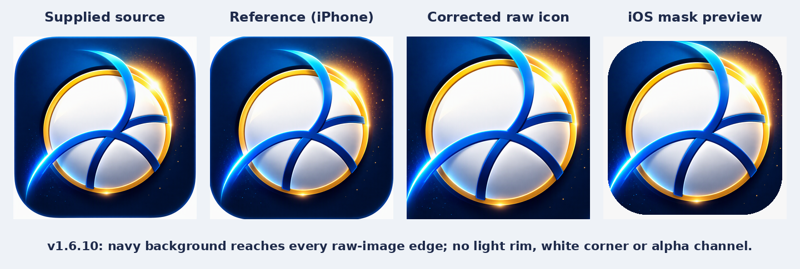

# Implementation report — Volley Live Capture v1.6.10

## Scope
v1.6.10 starts exclusively from the published complete `Volley_statistics_v1.6.9.zip` package. It corrects the application artwork while preserving all v1.6.9 Modification UI 7 code and behaviour: compact equal score spacing, net-height-contained posts and the dashed BENCH/input separation.

## Delivered icon correction
1. The supplied 1254 × 1254 `IMG_5596.PNG` remains the sole artwork source.
2. The complete 96 px pre-rendered rounded-corner/light-rim perimeter is cropped away; the clean square is resized to a corrected 1254 × 1254 master using Lanczos resampling.
3. The following RGB PNG files are regenerated from that master:
   - `icons/apple-touch-icon.png` — 180 × 180;
   - `icons/favicon-32.png` — 32 × 32;
   - `icons/icon-192.png` — 192 × 192;
   - `icons/icon-512.png` — 512 × 512.
4. Every output is square and fully opaque. Navy pixels reach each edge and corner; there is no pale perimeter, white/transparent corner or pre-rendered rounded mask.
5. The manifest icon purpose is `any`; iOS and other launchers apply their own rounded mask.
6. The visible app version and PWA cache advance to v1.6.10.

## Visual preview
The comparison below shows the supplied source, the user-provided iPhone reference, the corrected full-square icon and a simulated iOS mask.

The same comparison is included as page 5 of `Volley_Live_Capture_Screens_v1.6.10.pdf`.

## Code and compatibility
- `index.html` shows v1.6.10.
- `sw.js` uses cache `volley-live-capture-v1.6.10` and pre-caches all four icon outputs.
- `manifest.webmanifest` continues to expose 192 px and 512 px icons.
- Scoring, service ownership, event capture, substitutions, rotation, history and format-version-1 portable match data are unchanged.
- v1.6.9 score, net and BENCH-divider acceptance tests remain active.

## Documentation and evidence
- English UI functional specification advanced to document version 2.0 with section `9.9 Borderless application artwork (v1.6.10)` and catalogue case `ICON10-01`.
- All 11 original inline source images and all 22 original Word media entries are retained.
- The five-page screenshot PDF contains the four current v1.6.9-equivalent capture states plus a dedicated v1.6.10 icon comparison page.
- Changelog, release notes, iPhone installation guidance, architecture, functional/implementation specifications and test plan are updated together.

## Verification
- Automated suite: **25 passed**.
- Word OOXML validation against the complete v1.6.9 source: **passed**.
- Word render: **21 Letter pages**, visually inspected.
- Screenshot PDF: **5 Letter pages**, rendered and visually inspected.
- Icon checks verify exact sizes, RGB mode, navy corners, absence of a material pale outer band, corrected-master derivation, manifest references and cache version.

## iPhone cache note
If iOS still displays an older light-bordered icon, remove the existing Home-screen shortcut and add it again from Safari after deploying all v1.6.10 files. Touch-icon caching is independent from the application shell cache.
