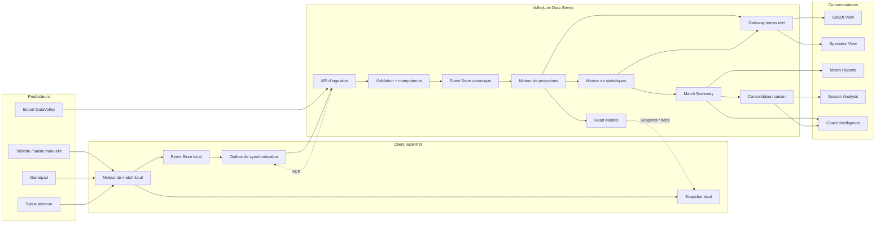
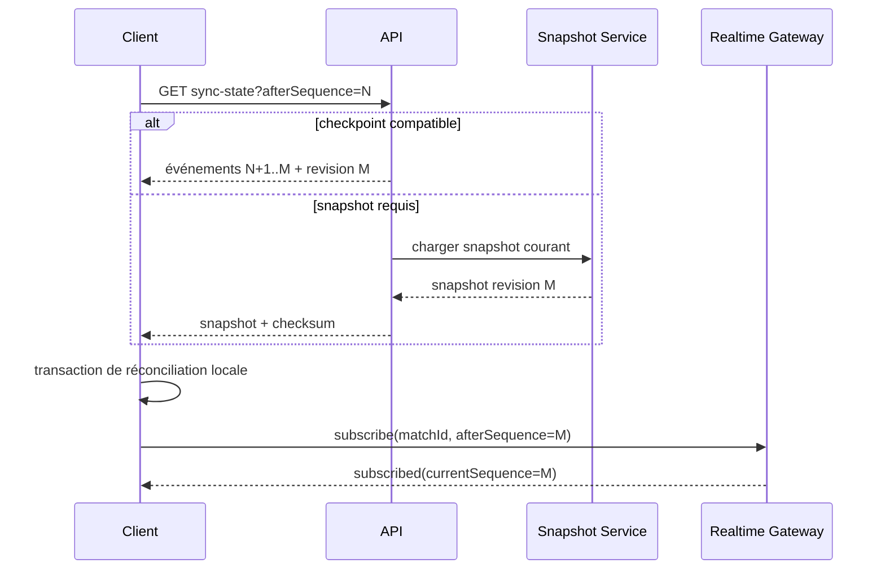
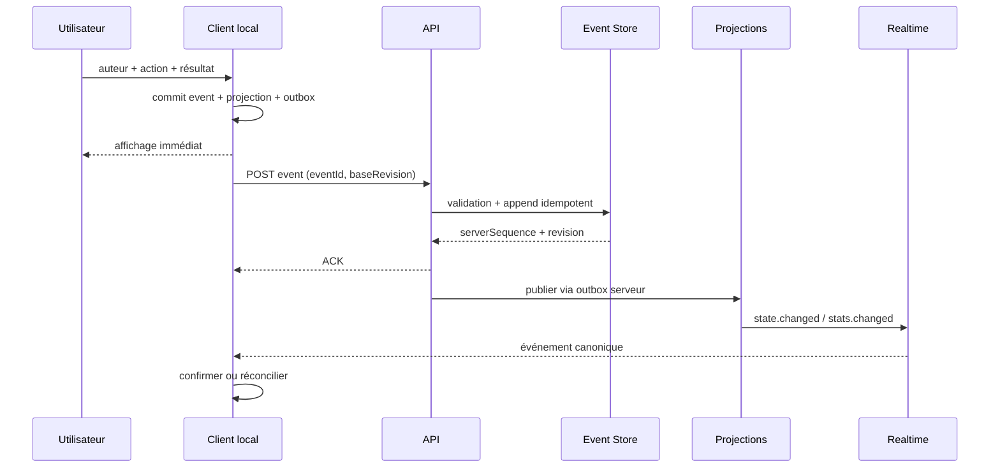
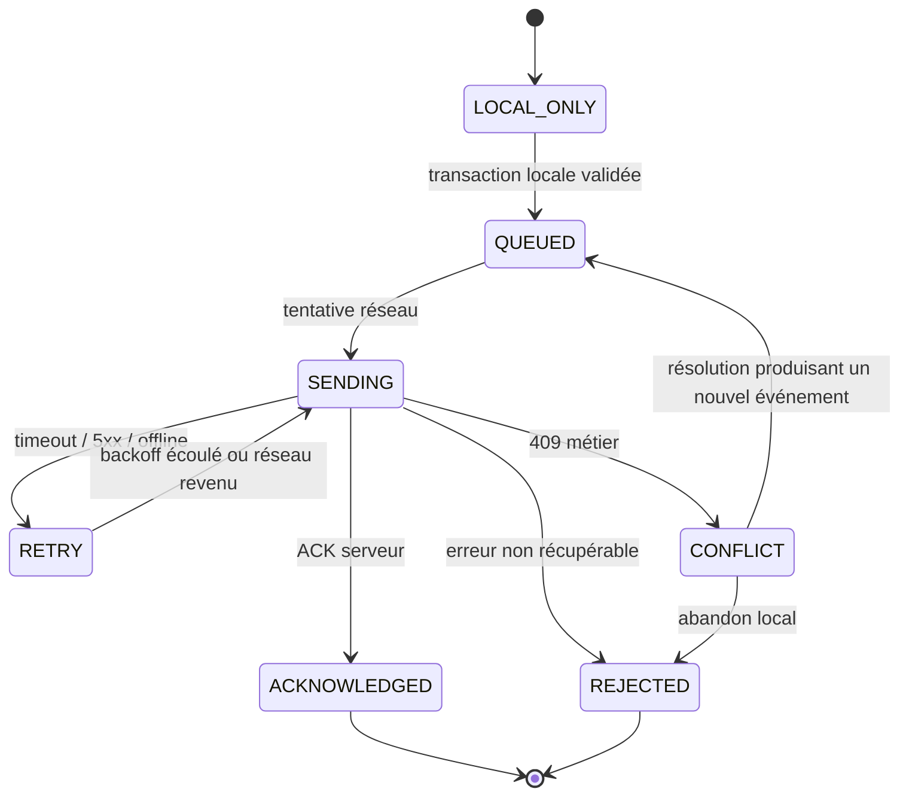
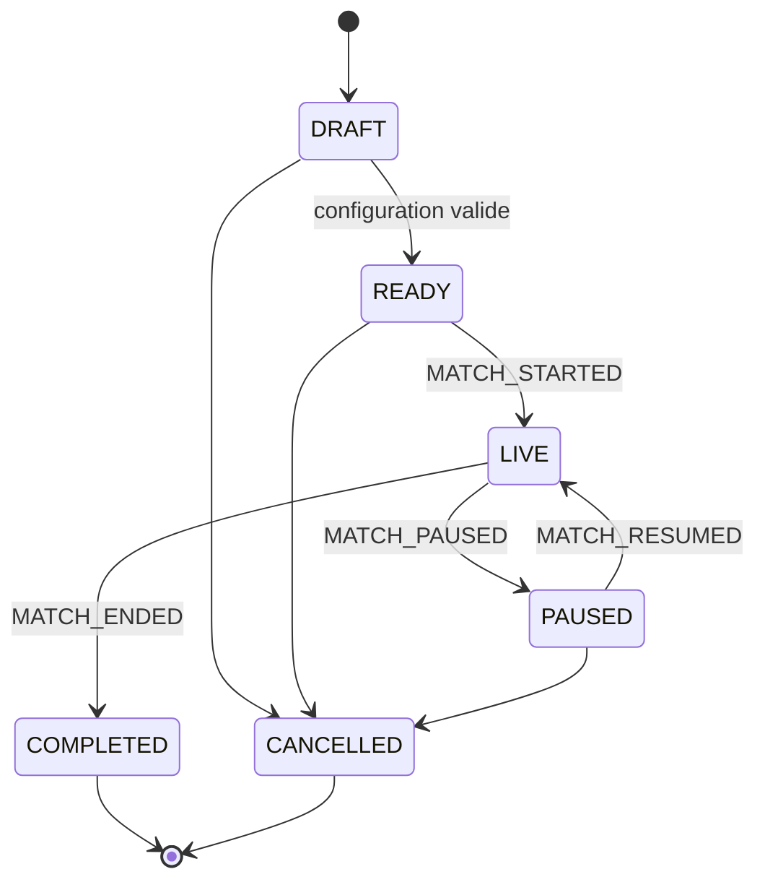

# VolleyLive — Spécification détaillée de l’architecture Data & Synchronisation

**Statut :** Base d’implémentation  
**Version du document :** 1.0.0  
**Date :** 2026-11-27  
**Cible :** application web/PWA mobile-first, tablette et téléphone  
**Schéma de données de référence :** `volley-live`, `schemaVersion: 2.1.0`  
**Langue normative :** français ; les identifiants techniques et valeurs d’énumération restent en anglais

## Table des matières

1. Objet et objectifs
2. Décisions d’architecture
3. Architecture globale
4. Modèle de domaine canonique
5. Producteurs de données
6. Client local-first
7. VolleyLive Data Server
8. Moteur de statistiques
9. Match Summary JSON
10. Consolidation saisonnière
11. Consommateurs
12. Protocole de synchronisation
13. API HTTP
14. Persistance et cohérence
15. Sécurité et confidentialité
16. Observabilité
17. Performance et disponibilité
18. Validation métier
19. Tests
20. Stratégie d’implémentation
21. Structure de code
22. Compatibilité et migrations
23. Décisions restant à formaliser
24. Critères d’acceptation
25. Definition of Done

---

## 1. Objet du document

Cette spécification définit les composants, contrats de données et mécanismes nécessaires pour implémenter l’environnement VolleyLive suivant :

1. producteurs de données ;
2. stockage local et fonctionnement hors ligne ;
3. serveur de données VolleyLive ;
4. moteur d’événements et moteur de match ;
5. moteur de statistiques ;
6. `Match Summary JSON` ;
7. consolidation saisonnière ;
8. consommateurs live et post-match ;
9. synchronisation, accusés de réception, reprises, snapshots et résolution de conflits.

Elle constitue le contrat de référence entre le front-end, le back-end, les imports, les vues live, les statistiques et les rapports.

### 1.1 Vocabulaire normatif

- **DOIT / NE DOIT PAS** : exigence obligatoire.
- **DEVRAIT / NE DEVRAIT PAS** : recommandation forte, dérogation documentée nécessaire.
- **PEUT** : fonctionnalité facultative.

### 1.2 Objectifs

- garantir une saisie immédiate même sans réseau ;
- maintenir une source de vérité unique côté serveur dès que celui-ci est joignable ;
- ne jamais créer deux points ou deux événements à cause d’une nouvelle tentative réseau ;
- rendre le match entièrement reconstructible depuis les événements canoniques ;
- recalculer les statistiques à partir des données source, sans correction manuelle d’agrégats ;
- permettre plusieurs consommateurs simultanés sans synchronisation directe entre eux ;
- supporter la correction et l’annulation sans effacer l’historique d’audit ;
- conserver la compatibilité avec le format portable VolleyLive 2.1.0 et les imports DataVolley ;
- séparer les données brutes, l’état courant et les données analytiques dérivées.

### 1.3 Hors périmètre initial

- arbitrage vidéo ;
- paiement, abonnement ou licence ;
- diffusion vidéo ;
- intelligence artificielle générative pendant le rallye ;
- fusion automatique de deux historiques concurrents lorsque les deux appareils ont modifié le score ;
- gestion exhaustive des règlements propres à chaque fédération, hors règles configurables décrites ici.

---

## 2. Décisions d’architecture

### 2.1 Principes obligatoires

1. **Event sourcing métier** : les actions et changements de match sont enregistrés sous forme d’événements immuables.
2. **Local-first** : la saisie est d’abord commitée dans une transaction locale, puis synchronisée.
3. **Serveur autoritaire** : le serveur attribue l’ordre global et publie l’état canonique.
4. **Idempotence** : un même `eventId` soumis plusieurs fois produit un seul événement serveur.
5. **Projections recalculables** : score, rotations, statistiques et résumés sont des projections des événements valides.
6. **Séparation RAW / DERIVED** : les événements source ne sont jamais remplacés par des statistiques agrégées.
7. **Corrections explicites** : une correction ou annulation référence l’événement remplacé ou invalidé.
8. **Contrats versionnés** : événements, snapshots, API et exports portent une version de schéma.
9. **Aucun couplage entre vues** : Coach View et Spectator View reçoivent leurs données du serveur, jamais l’une de l’autre.
10. **Ordre explicite** : l’ordre serveur repose sur `serverSequence`, jamais uniquement sur l’horodatage.

### 2.2 Profil technique de référence

Le comportement est normatif ; les technologies peuvent être remplacées si les contrats sont conservés.

| Zone | Profil recommandé |
|---|---|
| Client | PWA TypeScript, service worker, IndexedDB |
| API synchrone | HTTPS REST/JSON |
| Temps réel | WebSocket ; SSE acceptable pour les consommateurs read-only |
| Base transactionnelle | PostgreSQL |
| Cache/projections live | Redis facultatif |
| Traitements asynchrones | file durable ou table outbox |
| Schémas | JSON Schema + validation à l’entrée |
| Authentification | OIDC/OAuth2, jetons courts |
| Observabilité | logs structurés, métriques, traces distribuées |

---

## 3. Architecture globale



### 3.1 Flux nominal

```text
Saisie utilisateur
  → validation locale
  → création d’un eventId
  → transaction locale : event + projection + outbox
  → affichage immédiat
  → envoi au serveur
  → validation/idempotence
  → attribution de serverSequence
  → ACK
  → projection serveur
  → diffusion temps réel
  → convergence des clients
```

### 3.2 Deux catégories de données

#### Données source

- match, équipes, joueurs et règles figés pour le match ;
- sets, rallyes, lineups et substitutions ;
- actions de jeu ;
- score avant/après ;
- timeouts, sanctions et notes si activés ;
- corrections et annulations ;
- métadonnées de provenance.

#### Données dérivées

- état courant du match ;
- score live ;
- rotations et phase service/réception ;
- efficacité par action ;
- side-out et break-point ;
- classements joueurs ;
- courbes et tendances ;
- `Match Summary JSON` ;
- agrégats saisonniers.

Les données dérivées NE DOIVENT PAS devenir l’unique source permettant de reconstruire le match.

---

## 4. Modèle de domaine canonique

### 4.1 Document portable de match

Le document exporté/importé respecte cette structure racine :

```json
{
  "format": "volley-live",
  "schemaVersion": "2.1.0",
  "documentType": "match",
  "generatedAt": "2026-11-27T14:00:00.000Z",
  "match": {},
  "teams": [],
  "players": [],
  "sets": [],
  "lineups": [],
  "rallies": [],
  "events": [],
  "live": {},
  "dataQuality": {}
}
```

### 4.2 Identifiants

Tous les identifiants sont des chaînes stables et opaques. UUID v7 est recommandé pour les nouveaux objets.

| Identifiant | Usage |
|---|---|
| `matchId` | match |
| `teamId` | équipe |
| `playerId` | joueur dans le référentiel |
| `setId` | set |
| `rallyId` | échange |
| `lineupVersionId` | version de composition valable pour un intervalle |
| `eventId` | événement métier et clé d’idempotence |
| `clientId` | installation cliente |
| `deviceId` | appareil physique/logique |
| `correlationId` | commande utilisateur ou lot de synchronisation |
| `causationId` | événement ayant causé un nouvel événement |

Un nom, numéro de maillot ou libellé NE DOIT PAS être utilisé comme clé primaire.

### 4.3 Énumérations canoniques

#### `ActionType`

```text
SERVICE
RECEPTION
SET
ATTACK
BLOCK
DEFENSE
FREEBALL
OPPONENT_ACTION
```

#### `ActionEvaluation`

```text
POINT
NEUTRAL
ERROR
```

#### Adaptation UI et compatibilité

| Valeur UI/ancienne | Valeur canonique |
|---|---|
| `POSITIVE` | `POINT` |
| `CONTINUE` | `NEUTRAL` |
| `SERVE` | `SERVICE` |
| `DEFENCE` | `DEFENSE` |
| `RELANCE` | `FREEBALL` |
| codes `Sv`, `R`, `St`, `A`, `B`, `D`, `F` | valeurs longues correspondantes |

Les adaptateurs d’import et d’UI effectuent cette conversion. Le stockage canonique n’accepte qu’une seule orthographe par valeur.

#### Autres énumérations

```text
MatchLifecycleStatus = DRAFT | READY | LIVE | PAUSED | COMPLETED | CANCELLED
SetStatus            = NOT_STARTED | LIVE | COMPLETED | CANCELLED
RallyStatus          = OPEN | CLOSED | VOIDED
TeamPhase            = SERVE | RECEPTION
PlayerRole           = SET | OH | MB | OPP | LIB | UNKNOWN
EventStatus          = PENDING | ACTIVE | SUPERSEDED | VOIDED | REJECTED
Provenance           = LIVE_CAPTURE | GAMEPAD | DATAVOLLEY | IMPORT | SYSTEM | CORRECTION
SyncState             = LOCAL_ONLY | QUEUED | SENDING | ACKNOWLEDGED | RETRY | CONFLICT | REJECTED
RallyOutcome         = LOST | BREAK_POINT | SIDE_OUT
```

### 4.4 Enveloppe d’événement

Tout événement synchronisable DOIT contenir :

```json
{
  "schemaVersion": "2.1.0",
  "eventId": "019b-event-uuid",
  "eventType": "ACTION_RECORDED",
  "matchId": "match-uuid",
  "setId": "set-2",
  "rallyId": "set-2-rally-12",
  "clientId": "client-uuid",
  "deviceId": "device-uuid",
  "clientSequence": 148,
  "serverSequence": null,
  "baseRevision": 351,
  "occurredAt": "2026-11-27T14:12:01.202Z",
  "recordedAt": "2026-11-27T14:12:01.260Z",
  "correlationId": "command-uuid",
  "causationId": null,
  "provenance": "LIVE_CAPTURE",
  "payload": {}
}
```

Règles :

- `eventId` est créé avant la première écriture locale ;
- `clientSequence` est strictement croissant par `clientId` et `matchId` ;
- `serverSequence` est attribué par le serveur, strictement croissant par match ;
- `baseRevision` est la dernière révision serveur connue au moment de la commande ;
- `occurredAt` décrit l’instant métier estimé ;
- `recordedAt` décrit l’écriture locale ;
- l’ordre canonique utilise `serverSequence` ;
- les timestamps ne sont pas une autorité d’ordre.

### 4.5 Types d’événements obligatoires

| Événement | Finalité |
|---|---|
| `MATCH_CREATED` | création et règles |
| `MATCH_STARTED` | passage à l’état live |
| `PLAYER_REGISTERED` | snapshot du roster de match |
| `SET_STARTED` | set et composition initiale |
| `RALLY_STARTED` | contexte immuable du rallye |
| `ACTION_RECORDED` | contact/action unitaire |
| `RALLY_ENDED` | vainqueur et score après rallye |
| `LINEUP_CHANGED` | substitution ou remplacement libero |
| `TIMEOUT_RECORDED` | temps mort |
| `SET_ENDED` | clôture du set |
| `MATCH_PAUSED` | suspension volontaire |
| `MATCH_RESUMED` | reprise |
| `MATCH_ENDED` | clôture du match |
| `EVENT_CORRECTED` | remplacement explicite |
| `EVENT_VOIDED` | annulation logique |

### 4.6 `ACTION_RECORDED`

```json
{
  "eventType": "ACTION_RECORDED",
  "eventId": "evt-uuid",
  "matchId": "match-uuid",
  "setId": "set-2",
  "rallyId": "set-2-rally-12",
  "clientSequence": 148,
  "baseRevision": 351,
  "payload": {
    "setNumber": 2,
    "rallyNumber": 12,
    "actionOrder": 4,
    "teamId": "team-home",
    "playerId": "player-08",
    "actionType": "ATTACK",
    "evaluation": "POINT",
    "scoreBefore": {"our": 18, "opponent": 16},
    "scoreAfter": {"our": 19, "opponent": 16},
    "phase": "RECEPTION",
    "setterRotation": "P2",
    "lineupVersionId": "lineup-v7",
    "inputMode": "SPEED_PLUS"
  }
}
```

Champs obligatoires : `eventId`, `matchId`, `setId`, `rallyId`, `actionOrder`, `teamId`, `actionType`, `evaluation`, `scoreBefore`, `scoreAfter`, `phase`, `setterRotation`, `lineupVersionId`.

`playerId` est obligatoire pour une action attribuée à un joueur. Il est nul pour une action adverse générique.

### 4.7 Rallye

Un rallye DOIT figer :

- score avant ;
- équipe au service et équipe en réception ;
- phase du point de vue de l’équipe analysée ;
- rotation du passeur `P1` à `P6` ;
- `lineupVersionId` ;
- six joueurs effectivement sur le terrain ;
- ordre des actions ;
- équipe gagnante et score après clôture.

```json
{
  "rallyId": "set-2-rally-12",
  "setId": "set-2",
  "setNumber": 2,
  "rallyNumber": 12,
  "status": "CLOSED",
  "servingTeamId": "team-away",
  "receivingTeamId": "team-home",
  "phaseAtStart": "RECEPTION",
  "setterRotationAtStart": "P2",
  "lineupVersionId": "lineup-v7",
  "onCourtPlayerIds": ["p1", "p2", "p3", "p4", "p5", "p6"],
  "scoreBefore": {"our": 18, "opponent": 16},
  "scoreAfter": {"our": 19, "opponent": 16},
  "winnerTeamId": "team-home",
  "terminalEventId": "evt-uuid"
}
```

### 4.8 Lineup et rotation

- Une version de lineup est immuable.
- Toute substitution crée un nouveau `lineupVersionId`.
- L’historique ne doit jamais être recalculé depuis le lineup courant.
- Une rotation est effectuée uniquement lorsque l’équipe gagne un rallye commencé en réception.
- Le remplacement libero doit conserver six joueurs actifs.
- Le passeur et sa position doivent être déterminables pour chaque rallye.

### 4.9 Correction et annulation

Un événement synchronisé n’est pas supprimé physiquement.

```json
{
  "eventType": "EVENT_VOIDED",
  "eventId": "void-uuid",
  "matchId": "match-uuid",
  "baseRevision": 352,
  "payload": {
    "targetEventId": "evt-to-void",
    "reasonCode": "WRONG_PLAYER",
    "comment": "Joueur #6 au lieu de #8"
  }
}
```

Pour remplacer une action :

1. créer le nouvel événement corrigé ;
2. créer `EVENT_CORRECTED` reliant ancien et nouveau ;
3. marquer l’ancien `SUPERSEDED` dans la projection ;
4. recalculer le rallye affecté ;
5. recalculer la suite du set si score, service, rotation ou lineup changent.

---

## 5. Producteurs de données

### 5.1 Tablette / saisie manuelle

#### Responsabilités

- collecter auteur, action et résultat ;
- utiliser FOCUS, SPEED+ ou FLOW sans modifier le contrat métier ;
- construire une commande locale valide ;
- demander au moteur de match l’impact sur le score ;
- persister atomiquement événement, projection locale et outbox ;
- afficher le nouvel état sans attendre le réseau.

#### Parcours commun

```text
Auteur → Action → Résultat → Commit local immédiat
```

La saisie standard doit rester possible en trois pressions. Un double tap sur le résultat ne doit créer qu’un seul `eventId`.

#### Modes

- **FOCUS** : écrans successifs auteur/action/résultat.
- **SPEED+** : terrain permanent, commandes contextuelles.
- **FLOW** : auteur, action et résultat visibles simultanément.

Les trois modes produisent des événements identiques, sauf `inputMode`.

### 5.2 Gamepad

Le gamepad est un adaptateur de commandes, pas un moteur métier.

#### Pipeline

```text
Signal physique → mapping de profil → commande VolleyLive → validation → événement canonique
```

#### Exigences

- profil de touches versionné ;
- anti-rebond configurable, valeur initiale recommandée : 150 ms ;
- aucune création d’événement sur relâchement si l’appui a déjà été traité ;
- désactivation des mappings ambigus ;
- feedback visuel de la commande interprétée ;
- même mécanisme d’idempotence que l’écran tactile ;
- possibilité de reprendre au tactile une sélection commencée au gamepad.

### 5.3 Import DataVolley

L’import est un producteur par lot.

#### Étapes

1. lire le fichier comme donnée non fiable ;
2. détecter version et encodage ;
3. parser les équipes, joueurs, sets, rotations, rallyes et actions ;
4. convertir les codes DataVolley vers les énumérations canoniques ;
5. générer des identifiants stables et déterministes lorsque possible ;
6. construire les lineups par rallye ;
7. valider score et ordre ;
8. produire un rapport `dataQuality` ;
9. enregistrer le lot de manière atomique ;
10. déclencher les projections et statistiques.

#### Règles

- conserver le code source brut dans `source.rawCode` ;
- conserver le numéro de ligne source ;
- ne pas inventer une information absente sans indicateur d’inférence ;
- signaler `lineupVerified`, `rolesVerified` et les avertissements ;
- un réimport du même fichier ne doit pas créer un second match silencieusement ;
- proposer ouvrir l’existant, remplacer via migration contrôlée, importer comme copie ou annuler.

### 5.4 Saisie adverse

Deux niveaux sont supportés :

1. **Adversaire générique** : `teamId` adverse, `playerId: null` ;
2. **Roster adverse détaillé** : joueur adverse identifié.

Le bouton UI `A` n’est jamais enregistré comme joueur local. Une action adverse utilise les mêmes types et évaluations canoniques.

---

## 6. Client local-first

### 6.1 Composants

| Composant | Responsabilité |
|---|---|
| `InputController` | machine d’état de saisie |
| `LocalMatchEngine` | validation et transitions de match |
| `LocalEventStore` | journal local immuable |
| `LocalProjectionStore` | score, set, rotation et affichage courant |
| `SyncOutbox` | événements non confirmés |
| `SnapshotStore` | dernier snapshot serveur et projection locale |
| `SyncCoordinator` | envoi, reprise et réconciliation |
| `RealtimeClient` | réception des mises à jour serveur |
| `Repository` | abstraction de persistance ; l’UI n’accède pas directement à IndexedDB |

### 6.2 Stores locaux minimaux

```text
matches
match_events
match_projections
sync_outbox
sync_checkpoints
snapshots
user_preferences
import_jobs
```

### 6.3 Transaction de saisie

Une action utilisateur DOIT être persistée dans une transaction locale unique :

```text
BEGIN LOCAL TRANSACTION
  validate command
  create eventId
  append event
  apply event to local projection
  insert outbox item
  update match.updatedAt
COMMIT
render projection
```

En cas d’échec, aucune des écritures ne doit être visible et le score ne doit pas changer.

### 6.4 Outbox

```ts
interface SyncOutboxItem {
  eventId: string;
  matchId: string;
  clientSequence: number;
  baseRevision: number;
  state: 'QUEUED' | 'SENDING' | 'RETRY' | 'CONFLICT' | 'REJECTED';
  attemptCount: number;
  nextAttemptAt: string;
  lastErrorCode?: string;
  createdAt: string;
  updatedAt: string;
}
```

Un élément ACKé sort de l’outbox active, mais son événement reste dans le journal local.

### 6.5 État de connectivité

```text
ONLINE_SYNCED
ONLINE_PENDING
OFFLINE
RECONNECTING
CONFLICT
DEGRADED
```

L’interface doit afficher un état compréhensible sans bloquer la saisie hors ligne.

### 6.6 Snapshot local

Le snapshot local contient :

- `matchId` ;
- `revision` ;
- `lastServerSequence` ;
- état du match ;
- set actif ;
- score ;
- service, phase et rotation ;
- lineup courant ;
- compteurs de sets ;
- hash du snapshot ;
- instant de génération.

Le snapshot accélère le démarrage mais ne remplace pas les événements.

---

## 7. VolleyLive Data Server

### 7.1 API Gateway

Responsabilités :

- terminaison TLS ;
- authentification ;
- autorisation match/équipe ;
- limitation de débit ;
- taille maximale des requêtes ;
- identifiant de corrélation ;
- routage vers ingestion, lecture et temps réel.

### 7.2 Service d’ingestion

Pipeline obligatoire :

1. vérifier l’enveloppe JSON ;
2. vérifier `schemaVersion` ;
3. authentifier le client ;
4. autoriser l’accès au match ;
5. vérifier l’idempotence par `eventId` ;
6. valider les références et règles métier ;
7. détecter un conflit de révision ;
8. attribuer `serverSequence` et nouvelle `revision` ;
9. écrire événement et outbox serveur dans la même transaction ;
10. retourner l’ACK ;
11. projeter et publier de manière asynchrone ou transactionnelle selon la criticité.

### 7.2.1 Match Event Engine

Le `Match Event Engine` est la porte d’entrée métier centrale. Il reçoit une commande validée, charge l’état à `baseRevision`, applique les invariants du moteur de match et produit zéro, un ou plusieurs événements canoniques.

Exemples :

- `RecordAction` produit `ACTION_RECORDED` et, si l’action clôt le point, `RALLY_ENDED` ;
- `StartSet` produit `SET_STARTED` puis le premier `RALLY_STARTED` ;
- `CorrectAction` produit le nouvel événement puis `EVENT_CORRECTED` ;
- `UndoLastAction` produit `EVENT_VOIDED`, jamais une suppression physique.

Le composant DOIT être déterministe : une même commande appliquée au même état produit la même décision métier. La génération d’identifiants et d’horodatages est injectée afin de garder le cœur testable.

### 7.3 Event Store canonique

Table logique recommandée :

```sql
match_events(
  match_id,
  server_sequence,
  event_id,
  event_type,
  schema_version,
  client_id,
  device_id,
  client_sequence,
  base_revision,
  occurred_at,
  recorded_at,
  received_at,
  correlation_id,
  causation_id,
  provenance,
  payload_json,
  payload_hash,
  actor_id,
  PRIMARY KEY(match_id, server_sequence),
  UNIQUE(event_id),
  UNIQUE(match_id, client_id, client_sequence)
)
```

Les événements sont append-only. Les statuts `VOIDED` et `SUPERSEDED` sont des projections obtenues par événements de correction.

### 7.4 Read Models

Read models recommandés :

- `match_current_state` ;
- `match_list_summary` ;
- `set_state` ;
- `rally_state` ;
- `lineup_history` ;
- `player_match_statistics` ;
- `rotation_statistics` ;
- `match_summary` ;
- `season_team_statistics` ;
- `season_player_statistics`.

Chaque projection contient `sourceRevision` afin de vérifier sa fraîcheur.

### 7.5 Moteur de match

Le moteur de match est une fonction déterministe :

```ts
nextState = apply(currentState, event)
```

Il gère :

- cycle de vie du match ;
- début et fin de set ;
- ouverture et clôture des rallyes ;
- score ;
- service et phase ;
- rotation ;
- substitutions et libero ;
- règles de victoire configurées ;
- validation des transitions impossibles.

Le même jeu de règles doit être partageable entre client et serveur ou couvert par des tests de conformité identiques.

### 7.6 Moteur de projections

- consomme les événements dans l’ordre `serverSequence` ;
- traite un événement au plus une fois par projection ;
- mémorise le dernier offset ;
- peut reconstruire une projection complète ;
- peut reconstruire seulement le set affecté ;
- publie un changement uniquement après commit de la projection.

### 7.7 Outbox serveur

La transaction d’ingestion écrit :

- l’événement canonique ;
- un message dans `server_outbox`.

Un worker publie ensuite le message vers les projections et la gateway temps réel. Cela évite qu’un événement validé soit perdu entre base de données et diffusion.

### 7.8 Service Snapshot

Un snapshot serveur est généré :

- au démarrage d’un set ;
- à la fin d’un set ;
- tous les N événements, valeur initiale recommandée : 50 ;
- après une correction entraînant une reconstruction importante ;
- à la demande si aucun snapshot récent n’existe.

Le snapshot est signé par un hash de contenu et lié à une `revision`.

---

## 8. Moteur de statistiques

### 8.1 Entrées

Le moteur utilise uniquement :

- événements actifs ;
- rallyes valides ;
- snapshots de lineup par rallye ;
- rôle du joueur figé pour le match ;
- phase et rotation au début du rallye.

Les couleurs et textes UI ne sont jamais des entrées statistiques.

### 8.2 Formules minimales

```text
Touches joueur        = nombre d’ACTION_RECORDED valides du joueur
Points                 = nombre d’évaluations POINT
Erreurs                = nombre d’évaluations ERROR
Points nets            = Points - Erreurs

Tentatives attaque     = ATTACK
Kills attaque          = ATTACK + POINT
Erreurs attaque        = ATTACK + ERROR
Efficacité attaque     = (Kills - Erreurs) / Tentatives

Tentatives service     = SERVICE
Aces                   = SERVICE + POINT
Erreurs service        = SERVICE + ERROR
Efficacité service     = (Aces - Erreurs) / Tentatives

Tentatives block       = BLOCK
Points block           = BLOCK + POINT
Erreurs block          = BLOCK + ERROR
Efficacité block       = (Points - Erreurs) / Tentatives

Réceptions positives   = RECEPTION + (POINT ou NEUTRAL)
Réception positive %   = Réceptions positives / Tentatives réception

Défenses positives     = DEFENSE + (POINT ou NEUTRAL)
Défense positive %     = Défenses positives / Tentatives défense

Side-out attempts      = rallyes commençant en RECEPTION
Side-outs réussis      = ces rallyes gagnés par notre équipe
Side-out %             = réussis / attempts

Break-point attempts   = rallyes commençant en SERVE
Break points           = ces rallyes gagnés par notre équipe
Break-point %          = gagnés / attempts
```

Si le dénominateur vaut zéro, retourner `null` et afficher `—`, jamais `0 %`.

### 8.3 Dimensions de regroupement

- match, set et rallye ;
- équipe ;
- joueur ;
- rôle ;
- rotation `P1` à `P6` ;
- phase `SERVE` ou `RECEPTION` ;
- type d’action ;
- évaluation ;
- résultat de rallye ;
- intervalle de séquences.

### 8.4 Résultat de rallye

```text
si winnerTeamId != ourTeamId → LOST
sinon si phaseAtStart == SERVE → BREAK_POINT
sinon → SIDE_OUT
```

### 8.5 Recalcul

- correction sans impact de score : recalcul du rallye et des agrégats du set ;
- correction de score, service, rotation ou lineup : replay depuis le rallye affecté jusqu’à la fin du set ;
- correction de roster/rôle : recalcul des statistiques du match ;
- changement d’algorithme/version : rebuild complet des projections analytiques.

### 8.6 Version des agrégats

Toute sortie analytique contient :

```json
{
  "calculationVersion": "stats-1.0.0",
  "sourceSchemaVersion": "2.1.0",
  "sourceRevision": 354,
  "computedAt": "2026-11-27T14:12:02.010Z"
}
```

---

## 9. Match Summary JSON

### 9.1 Rôle

Le `Match Summary JSON` est le contrat stable entre :

- le moteur de statistiques ;
- les rapports HTML/PDF ;
- la consolidation saisonnière ;
- Coach Intelligence.

Il ne remplace pas le document complet de match.

### 9.2 Structure minimale

```json
{
  "format": "volley-live-match-summary",
  "schemaVersion": "1.0.0",
  "matchId": "match-uuid",
  "sourceRevision": 354,
  "calculationVersion": "stats-1.0.0",
  "generatedAt": "2026-11-27T14:20:00.000Z",
  "identity": {
    "competition": null,
    "matchDate": "2026-11-27",
    "ourTeamId": "team-home",
    "opponentTeamId": "team-away"
  },
  "result": {
    "status": "COMPLETED",
    "setsWon": {"our": 3, "opponent": 1},
    "setScores": [
      {"setNumber": 1, "our": 25, "opponent": 22}
    ]
  },
  "teamMetrics": {},
  "playerMetrics": [],
  "rotationMetrics": [],
  "setMetrics": [],
  "quality": {
    "complete": true,
    "warnings": []
  }
}
```

### 9.3 Règles

- génération idempotente par `(matchId, sourceRevision, calculationVersion)` ;
- `sourceRevision` doit correspondre aux événements utilisés ;
- tout avertissement de qualité affectant une métrique doit être exposé ;
- les rapports consomment le résumé et n’implémentent pas leurs propres formules ;
- un résumé antérieur peut être conservé pour audit, mais un seul est marqué courant.

---

## 10. Consolidation saisonnière

### 10.1 Entrées

Uniquement des `Match Summary JSON` compatibles et finalisés, sauf vue explicitement marquée live/provisoire.

### 10.2 Clé de consolidation

```text
seasonId + teamId + matchId + sourceRevision + calculationVersion
```

### 10.3 Agrégation

- sommer les numérateurs et dénominateurs avant de recalculer les pourcentages ;
- ne pas moyenner directement des pourcentages de matchs ;
- conserver le nombre de matchs et tentatives derrière chaque KPI ;
- dédupliquer par `matchId` ;
- remplacer l’ancienne contribution lorsqu’une nouvelle révision du même match arrive ;
- séparer les métriques incompatibles entre versions de calcul, ou migrer/recalculer.

### 10.4 Sorties

- tendances équipe ;
- tendances joueur ;
- comparaison par rôle ;
- efficacité par rotation ;
- side-out/break-point par match et période ;
- charge de participation par rallyes joués ;
- alertes de qualité ou échantillon insuffisant.

---

## 11. Consommateurs

### 11.1 Coach View

#### Données

- état live canonique ;
- événements récents ;
- KPIs live ;
- rotations ;
- joueurs sur le terrain ;
- tendances du set.

#### Comportement

- chargement initial par snapshot ;
- abonnement temps réel après `lastServerSequence` ;
- mise à jour incrémentale ;
- bannière `STALE` si la connexion est perdue ;
- aucune commande d’écriture dans le périmètre read-only ;
- possibilité d’ouvrir le détail ayant produit un KPI.

### 11.2 Spectator View

- données filtrées pour le public ;
- score, set, service, événements autorisés et statistiques simples ;
- aucune note privée, raison de correction ou donnée technique ;
- tolère un léger retard configuré si nécessaire ;
- même mécanisme snapshot + delta.

### 11.3 Match Reports

- source : `Match Summary JSON` courant ;
- formats : HTML, PDF ;
- génération déterministe ;
- mention de la révision et de la version de calcul ;
- noms et notes échappés avant rendu ;
- aucune exécution de contenu importé.

### 11.4 Season Analysis

- source : consolidation saisonnière ;
- filtres : période, compétition, adversaire, joueur, rôle, rotation ;
- affiche taille d’échantillon et couverture des données ;
- signale les matchs exclus ou partiels.

### 11.5 Coach Intelligence

- consomme uniquement des données analytiques versionnées ;
- toute recommandation doit être traçable vers les métriques et matchs sources ;
- distingue constat, comparaison et recommandation ;
- n’écrit jamais directement dans l’Event Store ;
- une annotation de coach éventuelle est créée par une API dédiée et auditée.

---

## 12. Protocole de synchronisation

### 12.1 Ouverture ou reprise d’un match



### 12.2 Envoi d’un événement



### 12.3 ACK

```json
{
  "status": "ACKNOWLEDGED",
  "matchId": "match-uuid",
  "eventId": "evt-uuid",
  "serverSequence": 352,
  "revision": 352,
  "acceptedAt": "2026-11-27T14:12:01.480Z",
  "projectionPending": false
}
```

Si l’`eventId` existe déjà avec le même hash, retourner le même ACK avec `idempotentReplay: true`. S’il existe avec un contenu différent, retourner `409 EVENT_ID_PAYLOAD_MISMATCH`.

### 12.4 Batch hors ligne

```http
POST /api/v1/matches/{matchId}/events:batch
```

```json
{
  "clientId": "client-uuid",
  "fromClientSequence": 140,
  "events": [],
  "lastKnownServerSequence": 340
}
```

Réponse :

```json
{
  "matchId": "match-uuid",
  "results": [
    {"eventId": "e1", "status": "ACKNOWLEDGED", "serverSequence": 341},
    {"eventId": "e2", "status": "CONFLICT", "code": "STALE_SCORE_BASE"}
  ],
  "currentRevision": 341,
  "requiresResync": true
}
```

Le serveur traite dans l’ordre `clientSequence`. Le batch peut être partiellement accepté uniquement si les dépendances restent valides. Sinon, utiliser le mode atomique `atomic=true`.

### 12.5 Retry

- tentative immédiate après écriture locale ;
- backoff exponentiel avec jitter ;
- délais recommandés : 1 s, 2 s, 5 s, 10 s, 30 s, puis 60 s maximum ;
- nouvelle tentative immédiate au retour réseau ;
- pas de limite destructive : l’événement reste en attente jusqu’à action explicite ;
- erreurs 4xx métier non transitoires : état `REJECTED` ou `CONFLICT` ;
- erreurs 408, 429 et 5xx : retry ;
- respecter `Retry-After`.

### 12.6 Idempotence

Clé principale : `eventId`.

Contrôles supplémentaires :

- unicité `(matchId, clientId, clientSequence)` ;
- hash stable du payload ;
- `correlationId` pour empêcher un double commit d’une même commande UI ;
- ACK rejouable ;
- projection idempotente par dernier `serverSequence` appliqué.

### 12.7 Ordonnancement

- le client peut afficher un ordre optimiste local ;
- le serveur attribue l’ordre canonique ;
- à la réception d’un ordre différent, le client rejoue sa projection ;
- deux événements du même rallye ne peuvent avoir le même `actionOrder` actif ;
- un événement dépendant d’un rallye non encore créé est mis en attente de dépendance ou rejeté avec un code explicite ;
- le serveur ne trie jamais uniquement sur `occurredAt`.

### 12.8 Reconnexion et delta

Le client envoie son `lastServerSequence`.

- si le delta est disponible : serveur renvoie les événements suivants ;
- si le delta est trop ancien ou incompatible : serveur renvoie `SNAPSHOT_REQUIRED` ;
- le client applique delta/snapshot dans une transaction ;
- l’outbox locale est ensuite rejouée contre la nouvelle révision ;
- les événements locaux déjà présents côté serveur sont ACKés sans duplication.

### 12.9 Temps réel

#### Abonnement

```json
{
  "type": "subscribe",
  "matchId": "match-uuid",
  "afterSequence": 351,
  "channels": ["state", "events", "statistics"]
}
```

#### Message

```json
{
  "type": "match.state.changed",
  "matchId": "match-uuid",
  "serverSequence": 352,
  "revision": 352,
  "publishedAt": "2026-11-27T14:12:01.600Z",
  "payload": {
    "currentSetNumber": 2,
    "score": {"our": 19, "opponent": 16},
    "servingTeamId": "team-home"
  }
}
```

#### Garanties

- livraison au moins une fois ;
- déduplication côté client par `(matchId, serverSequence, type)` ;
- détection des trous de séquence ;
- appel delta si un trou est détecté ;
- heartbeat recommandé toutes les 20–30 secondes ;
- reconnexion automatique avec jitter.

### 12.10 Conflits

#### Conflits auto-résolus

- même `eventId`, même payload ;
- événements indépendants de notes ou télémétrie ;
- événement déjà ACKé mais ACK perdu ;
- delta temps réel reçu avant l’ACK HTTP.

#### Conflits nécessitant revalidation

- score de base différent ;
- rallye déjà clôturé ;
- action ajoutée dans un set terminé ;
- `actionOrder` occupé ;
- lineup obsolète ;
- rotation différente ;
- correction d’un événement déjà corrigé.

#### Politique recommandée

Pour le MVP, un seul **éditeur de score autoritaire** détient un lease par match. Les autres clients sont read-only ou produisent uniquement des événements non structurants autorisés.

```json
{
  "editorLease": {
    "holderClientId": "client-uuid",
    "leaseId": "lease-uuid",
    "expiresAt": "2026-11-27T14:13:00.000Z"
  }
}
```

Le lease est renouvelé tant que le client est actif. En mode hors ligne, le détenteur continue localement ; un autre appareil ne doit pas prendre le contrôle sans avertissement explicite.

### 12.11 Résolution manuelle

L’écran de conflit montre :

- événement local ;
- état serveur ;
- raison ;
- choix permis : abandonner local, appliquer comme correction, recharger, dupliquer comme note ;
- impact prévu sur score, rotation et statistiques.

Aucune fusion silencieuse ne doit modifier le score.

---

## 13. API HTTP

### 13.1 Endpoints minimaux

```text
POST /api/v1/matches
GET  /api/v1/matches
GET  /api/v1/matches/{matchId}
GET  /api/v1/matches/{matchId}/sync-state?afterSequence={n}
POST /api/v1/matches/{matchId}/events
POST /api/v1/matches/{matchId}/events:batch
GET  /api/v1/matches/{matchId}/events?afterSequence={n}&limit={n}
GET  /api/v1/matches/{matchId}/snapshot
GET  /api/v1/matches/{matchId}/state
GET  /api/v1/matches/{matchId}/statistics
GET  /api/v1/matches/{matchId}/summary
POST /api/v1/matches/{matchId}/summary:rebuild
POST /api/v1/matches/{matchId}/editor-lease
PUT  /api/v1/matches/{matchId}/editor-lease/{leaseId}
DELETE /api/v1/matches/{matchId}/editor-lease/{leaseId}
POST /api/v1/imports/datavolley
GET  /api/v1/imports/{jobId}
GET  /api/v1/seasons/{seasonId}/statistics
```

### 13.2 Conventions

- JSON UTF-8 ;
- timestamps ISO 8601 UTC ;
- pagination par curseur ;
- `ETag` sur snapshots et ressources de lecture ;
- `If-Match` possible pour commandes hors Event Store ;
- `X-Correlation-Id` propagé ;
- erreurs au format Problem Details.

### 13.3 Erreur

```json
{
  "type": "https://volleylive/errors/stale-score-base",
  "title": "Event conflicts with current match state",
  "status": 409,
  "code": "STALE_SCORE_BASE",
  "detail": "Expected 19-16, received 18-16",
  "fieldErrors": [
    {"path": "payload.scoreBefore", "code": "MISMATCH"}
  ],
  "matchId": "match-uuid",
  "currentRevision": 352,
  "correlationId": "corr-uuid"
}
```

### 13.4 Codes d’erreur minimaux

```text
INVALID_SCHEMA
UNSUPPORTED_SCHEMA_VERSION
MATCH_NOT_FOUND
MATCH_NOT_EDITABLE
EVENT_ID_PAYLOAD_MISMATCH
DUPLICATE_CLIENT_SEQUENCE
STALE_BASE_REVISION
STALE_SCORE_BASE
RALLY_NOT_OPEN
RALLY_ALREADY_CLOSED
INVALID_ACTION_ORDER
PLAYER_NOT_ON_COURT
INVALID_LINEUP
INVALID_ROTATION
SET_ALREADY_COMPLETED
EDITOR_LEASE_REQUIRED
EDITOR_LEASE_LOST
SNAPSHOT_REQUIRED
IMPORT_INVALID
IMPORT_DUPLICATE_MATCH
RATE_LIMITED
```

---

## 14. Persistance et cohérence

### 14.1 Transactions serveur

L’acceptation d’un événement doit atomiquement :

- insérer l’événement ;
- incrémenter la révision du match ;
- réserver `serverSequence` ;
- écrire l’outbox serveur ;
- enregistrer l’audit minimal.

### 14.2 Niveaux de cohérence

- **Écriture/ACK** : forte cohérence.
- **État live critique** : synchrone ou retard inférieur à l’objectif défini.
- **Statistiques live** : cohérence éventuelle courte.
- **Résumé et saison** : cohérence éventuelle, avec `sourceRevision` visible.

### 14.3 Rebuild

Chaque projection doit pouvoir être reconstruite depuis `serverSequence = 1`. Un rebuild s’exécute dans une nouvelle version de projection puis bascule atomiquement lorsque le résultat est valide.

### 14.4 Rétention et sauvegarde

- sauvegardes chiffrées ;
- politique de rétention configurable ;
- test de restauration périodique ;
- export portable par match ;
- aucune suppression physique d’audit avant expiration de la politique de conservation.

---

## 15. Sécurité et confidentialité

- TLS obligatoire ;
- autorisation au niveau équipe et match ;
- séparation lecture/édition/administration ;
- jetons jamais stockés dans les exports ;
- noms, notes et champs importés échappés ;
- protection contre prototype pollution et injections ;
- limites de taille : import JSON 10 Mo par défaut, batch configurable ;
- journalisation des imports, corrections, exports et prises de lease ;
- données personnelles minimales dans les événements ;
- identifiants internes dans les logs analytiques ;
- secrets exclus des logs ;
- rate limiting et protection anti-abus ;
- validation stricte des types, longueurs et énumérations.

### 15.1 Rôles d’accès

```text
OWNER          administration du match
SCORER         saisie et correction
COACH          lecture données privées et statistiques
SPECTATOR      lecture publique filtrée
REPORT_READER  lecture rapports
SYSTEM         projections et traitements internes
```

---

## 16. Observabilité

### 16.1 Logs structurés

Champs minimaux :

```text
timestamp, level, service, environment, correlationId,
matchId, eventId, clientId, serverSequence, revision,
operation, outcome, errorCode, durationMs
```

Ne pas journaliser le contenu complet d’un token ni des notes privées.

### 16.2 Métriques

- événements acceptés/rejetés par type ;
- taux de replay idempotent ;
- taille et âge maximal des outbox ;
- latence écriture locale ;
- latence API ACK ;
- latence événement → projection ;
- latence événement → diffusion ;
- connexions WebSocket ;
- reconnexions et trous de séquence ;
- conflits par code ;
- durée de rebuild ;
- erreurs d’import et avertissements qualité.

### 16.3 Alertes

- événement ACKé mais non projeté après seuil ;
- outbox serveur bloquée ;
- projection en retard ;
- taux de conflits anormal ;
- erreurs 5xx ;
- corruption de checksum snapshot ;
- échec de génération de résumé ;
- divergence entre score projeté et rallyes.

---

## 17. Exigences de performance et disponibilité

Objectifs initiaux à valider par tests de charge :

| Mesure | Objectif |
|---|---|
| feedback visuel local après tap | p95 < 100 ms |
| transaction locale d’une action | p95 < 50 ms |
| ACK API réseau nominal | p95 < 500 ms |
| événement → mise à jour temps réel | p95 < 1 s |
| ouverture depuis snapshot local | p95 < 1 s |
| reconstruction d’un set sur tablette | < 100 ms cible |
| calcul statistiques d’un set | < 200 ms cible serveur |
| disponibilité saisie locale | indépendante du serveur |
| perte d’événement après commit local | 0 attendue |

Dimensionnement fonctionnel indicatif par set : 35–65 rallyes, 80–250 actions et 7–14 joueurs par équipe. Les limites techniques doivent rester nettement supérieures.

---

## 18. Validation métier

### 18.1 Invariants

- un rallye fermé a exactement un vainqueur ;
- `scoreAfter` ajoute exactement un point à une équipe ;
- un set terminé respecte la cible et l’écart minimal configurés ;
- un joueur associé à une action locale est sur le terrain, sauf workflow de correction ;
- une rotation appartient à `P1..P6` ;
- un side-out commence en réception ;
- un break-point commence au service ;
- six joueurs sont présents dans chaque snapshot de lineup ;
- aucun événement voided ou superseded ne contribue aux agrégats ;
- les totaux d’équipe sont cohérents avec les événements valides ;
- la révision d’une projection ne dépasse jamais la révision du match.

### 18.2 Tolérances d’import

Une donnée importée peut être marquée non vérifiée sans bloquer l’import si :

- le score et les rallyes restent cohérents ;
- l’absence ne rend pas le match impossible à reconstruire ;
- un avertissement est ajouté dans `dataQuality` ;
- les métriques dépendantes sont marquées partielles.

---

## 19. Tests

### 19.1 Tests unitaires

- normalisation des énumérations ;
- règles de score et fin de set ;
- rotation et changement de service ;
- classification side-out/break-point ;
- formules statistiques et division par zéro ;
- application et replay d’événements ;
- correction/void ;
- déduplication ;
- backoff ;
- migration de schéma ;
- mapping DataVolley.

### 19.2 Tests de contrat

- validation JSON Schema de chaque événement ;
- compatibilité client/serveur ;
- format des ACK et erreurs ;
- messages temps réel ;
- `Match Summary JSON` ;
- imports/exports 2.1.0.

### 19.3 Tests d’intégration

Scénario de référence : set déterministe 25–22, 47 rallyes, toutes les rotations, substitutions, libero, chaque action et évaluation, une correction et une reconnexion.

Vérifier :

- score final ;
- 47 rallyes ;
- ordre des actions ;
- ACK perdu puis retry sans doublon ;
- lot offline ;
- reconnexion delta ;
- snapshot requis ;
- correction historique ;
- égalité des statistiques avant/après rebuild ;
- égalité entre vue horizontale et verticale ;
- génération du résumé.

### 19.4 Tests de concurrence

- deux soumissions du même `eventId` ;
- deux `eventId` pour le même `actionOrder` ;
- perte du lease éditeur ;
- correction simultanée ;
- message WebSocket reçu avant ACK ;
- changement de set pendant reconnexion ;
- reprise après crash entre événement et publication outbox.

### 19.5 Tests hors ligne

- démarrer connecté puis perdre le réseau ;
- saisir un set complet hors ligne ;
- fermer et rouvrir la PWA ;
- synchroniser après plusieurs heures ;
- recevoir un conflit de score ;
- vérifier qu’aucun événement n’est perdu ;
- vérifier que l’utilisateur distingue pending, synced et conflict.

### 19.6 Tests sécurité

- import JSON malveillant ;
- valeurs hors énumération ;
- payload trop grand ;
- accès à un match non autorisé ;
- replay avec payload modifié ;
- injection HTML dans les noms ;
- saturation de l’API ;
- token expiré pendant synchronisation.

### 19.7 Tests de non-régression

Un corpus d’exports réels anonymisés doit être conservé. Chaque version doit vérifier :

- import ;
- migration ;
- replay ;
- score ;
- statistiques ;
- réexport ;
- génération HTML/PDF.

---

## 20. Stratégie d’implémentation

### Lot 1 — Domaine et stockage local

- définir JSON Schema 2.1.0 ;
- implémenter événements et moteur de match pur ;
- implémenter IndexedDB/repository ;
- transaction event + projection + outbox ;
- tests de replay.

### Lot 2 — API et Event Store

- authentification et autorisation ;
- ingestion unitaire et batch ;
- idempotence ;
- `serverSequence` et révision ;
- outbox serveur ;
- read model état courant.

### Lot 3 — Synchronisation

- ACK/retry ;
- delta et snapshot ;
- WebSocket ;
- gestion des trous ;
- états UI de synchronisation ;
- lease éditeur.

### Lot 4 — Statistiques et résumé

- projections statistiques ;
- filtres et rotations ;
- `Match Summary JSON` ;
- rebuild ;
- tests de référence.

### Lot 5 — Consommateurs

- Coach View ;
- Spectator View ;
- Match Reports ;
- bibliothèque de matchs et reprise ;
- gestion du mode stale.

### Lot 6 — Saison et industrialisation

- consolidation saisonnière ;
- Coach Intelligence ;
- observabilité ;
- charge, sécurité, sauvegarde et restauration ;
- stratégie de migration.

---

## 21. Structure de code recommandée

```text
packages/
  domain/
    events/
    match-engine/
    scoring/
    rotations/
    schemas/
  statistics/
    metrics/
    projections/
    summary/
  sync-protocol/
    envelopes/
    errors/
    client/
apps/
  capture-pwa/
    input/
    local-store/
    sync/
  coach-view/
  spectator-view/
  api/
    ingestion/
    queries/
    realtime/
    imports/
  workers/
    projections/
    summaries/
    seasons/
```

Les packages `domain`, `statistics` et `sync-protocol` ne doivent dépendre d’aucun composant visuel.

---

## 22. Compatibilité et migrations

### 22.1 Versionnement

- MAJOR : rupture de compatibilité ;
- MINOR : ajout rétrocompatible ;
- PATCH : correction sans modification du contrat.

### 22.2 Lecture

Une version N doit lire :

- N ;
- versions mineures antérieures supportées ;
- versions migrables via adaptateur explicite.

### 22.3 Écriture

Le serveur écrit uniquement la version canonique active. Les exports indiquent précisément `schemaVersion` et `generatedAt`.

### 22.4 Migration

Une migration :

- ne modifie jamais le fichier source fourni ;
- produit un rapport ;
- conserve la provenance ;
- est idempotente ;
- possède des tests golden-file ;
- échoue entièrement si l’intégrité métier ne peut être garantie.

---

## 23. Points à décider avant production

Ces choix ne bloquent pas le socle, mais doivent être formalisés par ADR :

1. durée et politique exacte du lease éditeur ;
2. nombre maximal d’événements par batch ;
3. durée de rétention des journaux d’audit ;
4. WebSocket unique ou service temps réel managé ;
5. fréquence des snapshots ;
6. comportement exact en cas de match modifié sur deux appareils hors ligne ;
7. données autorisées dans Spectator View ;
8. métriques nécessitant une échelle de qualité plus riche que POINT/NEUTRAL/ERROR ;
9. politique de publication d’un résumé provisoire ;
10. limites de stockage local et stratégie de purge.

Aucun de ces points ne doit remettre en cause l’idempotence, le journal canonique ou la séparation source/dérivé.

---

## 24. Critères d’acceptation système

L’architecture est considérée implémentée lorsque :

- une action est visible localement sans réseau ;
- le redémarrage de l’application conserve les événements en attente ;
- la reconnexion synchronise le lot sans doublon ;
- un ACK perdu ne crée pas de second point ;
- le serveur attribue un ordre canonique ;
- Coach View et Spectator View convergent vers le même score ;
- un client détecte et récupère un trou de séquence ;
- une correction ne détruit pas l’événement original ;
- le replay reproduit le score, les rotations et statistiques ;
- le `Match Summary JSON` porte la révision source ;
- la consolidation remplace correctement une ancienne révision ;
- les imports DataVolley conservent provenance et avertissements qualité ;
- les contrôles d’accès empêchent une lecture ou écriture non autorisée ;
- les métriques d’observabilité permettent de diagnostiquer une synchronisation bloquée ;
- les tests de référence, hors ligne, concurrence, sécurité et migration passent.

---

## 25. Definition of Done

Une fonctionnalité liée aux données VolleyLive n’est terminée que si :

1. son événement ou read model est documenté ;
2. le schéma est versionné ;
3. les validations client et serveur existent ;
4. le comportement hors ligne est défini ;
5. l’idempotence est testée ;
6. les erreurs ont un code machine ;
7. les projections peuvent être reconstruites ;
8. les corrections sont auditées ;
9. les vues ne lisent pas directement un stockage non abstrait ;
10. les métriques, logs et alertes sont ajoutés ;
11. les tests unitaires, contrat, intégration et reprise passent ;
12. la compatibilité import/export est vérifiée ;
13. aucune donnée de démonstration n’est utilisée comme donnée réelle ;
14. la documentation et les ADR associés sont à jour.

---

## Annexe A — Machine d’état de synchronisation d’un événement



## Annexe B — Machine d’état du match



## Annexe C — Checklist de revue d’une pull request

- [ ] Pas de logique métier dupliquée dans l’UI.
- [ ] Aucun ordre basé uniquement sur un timestamp.
- [ ] `eventId` créé avant écriture locale.
- [ ] Transaction locale inclut l’outbox.
- [ ] Endpoint idempotent.
- [ ] `serverSequence` et `sourceRevision` propagés.
- [ ] Erreurs codifiées et testées.
- [ ] Projection rejouable.
- [ ] Correction sans suppression physique.
- [ ] Données importées traitées comme non fiables.
- [ ] Champs utilisateur échappés.
- [ ] Mode offline et reconnexion testés.
- [ ] Aucune donnée sensible dans logs ou exports.
- [ ] Documentation du schéma mise à jour.


## Annexe D — Références de conception consolidées

Cette spécification consolide et aligne les documents existants suivants :

- `VolleyLive_Statistics_Implementation_Specification.md` — événements, statistiques, timeline, corrections et formules ;
- `spécification_saisie_action.md` — modes FOCUS, SPEED+ et FLOW, transaction de saisie et idempotence locale ;
- `VolleyLive_Match_Hub_Implementation_Specification.md` — reprise de match, import et modèle de résumé de liste ;
- `VolleyLive_Match_Library_Redesign_Spec.md` — sélection d’un match et ouverture des vues Coach/Spectator/Reports ;
- `MIL76_VolleyLive_v1.25.0.json` — structure de document `volley-live` 2.1.0, lineups, rallyes, événements et qualité des données ;
- `IMPLEMENTATION_REPORT_v1.7.0.md` — contraintes de compatibilité PWA, capture, stockage local et import/export.

En cas de divergence, le présent document fixe le contrat transversal. En particulier, le stockage canonique utilise les valeurs longues de `ActionType` et `POINT | NEUTRAL | ERROR`; les valeurs UI ou historiques sont converties par les adaptateurs décrits en section 4.3.
