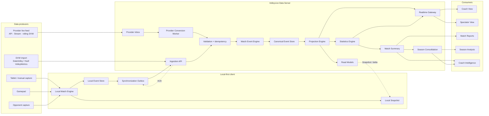
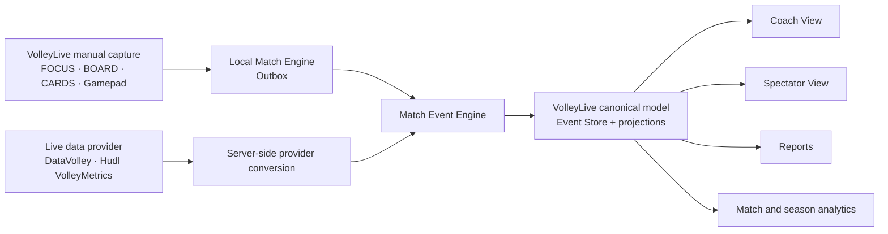
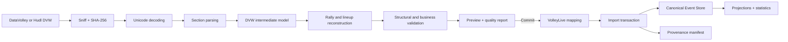
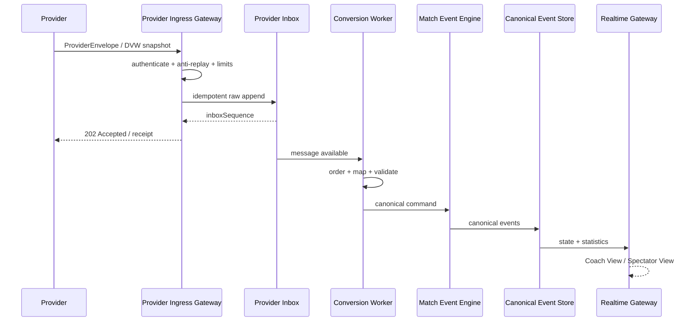
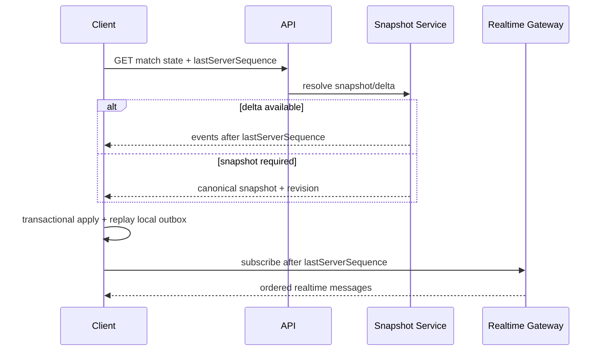
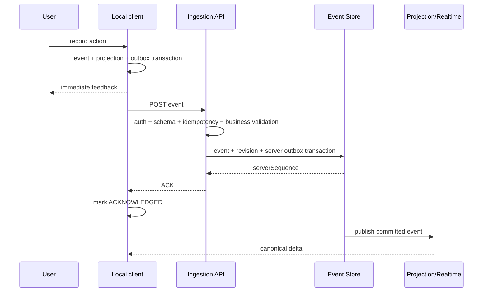
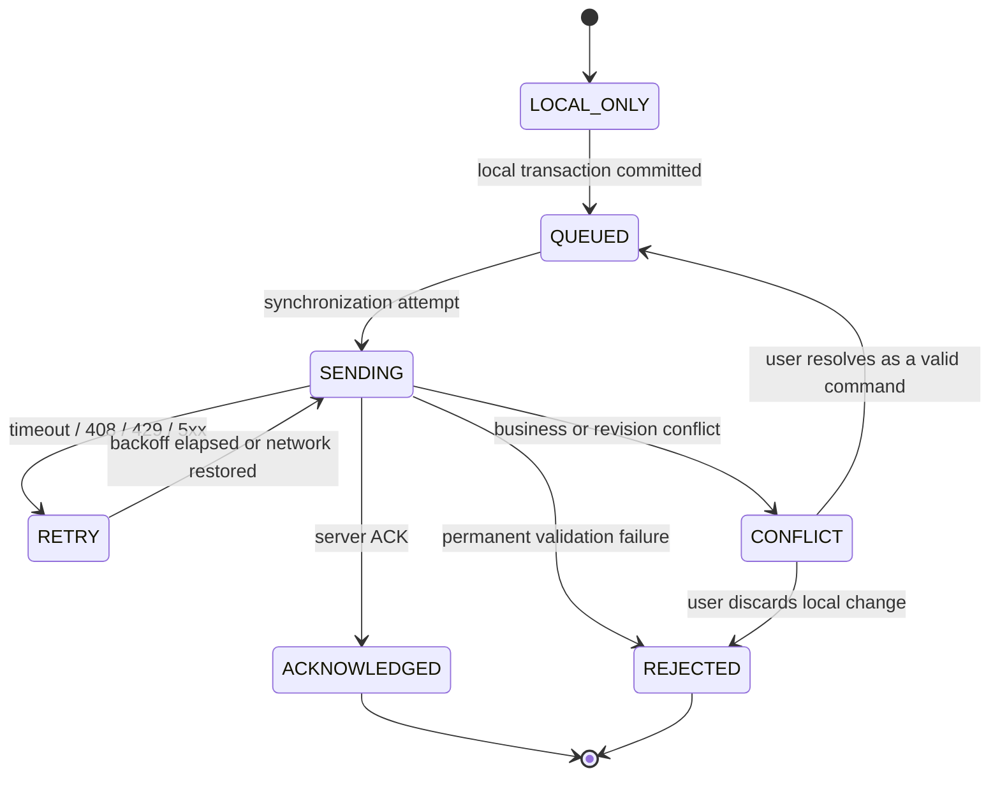

# SYS-SYNC — Data architecture and synchronization (target)

| Field | Value |
|---|---|
| Spec ID | `SYS-SYNC` (proposed; the spec moves to `docs/specs/` when it is implemented) |
| Status | Draft, not implemented (`TO_DO/`) |
| Version | 1.4.0 |
| Applies to | Target architecture after VolleyLive v1.28.0; reference document schema `volley-live` 2.1.0 |
| Last review | 2026-11-28 |
| Source of truth | None yet. The application as built is described by SYS-ARCH, SYS-DATA and SYS-JSON. |
| Related specs | Current: SYS-ARCH, SYS-DATA, SYS-JSON, SYS-SEC, SYS-PWA, SYS-QA, DOM-MATCH, DOM-LINEUP, DOM-ROTATION, DOM-LIBERO, DOM-SUBS, DOM-STATS, UI-CAPTURE, UI-HUB, UI-LIBRARY, UI-REPORTS, UI-COACH, UI-SPECTATOR. To do: `REALTIME_SHARING_WORKING_SPEC.md`, `PHYSICAL_GAMEPAD_INPUT.md`, `Match_Summary_JSON_Format_Spec.md`, `Consolidated_Report_Spec.md`, `VolleyLive_Specification_Unifiee_Coach_Intelligence_Coach_View_v2.0.md` |

**Target:** Mobile-first web/PWA application for tablets and phones  
**Normative language:** English; technical identifiers and enumeration values are in English. Interface texts follow SYS-I18N (French by default).

This document describes a target architecture. Where it differs from the application as built, Appendix F says which
current requirement changes; Appendix G lists the review findings and what is still open. A behaviour already
specified in `docs/specs/` is referenced, not redefined.

## Table of contents

1. Purpose and objectives
2. Architecture decisions
3. Overall architecture
4. Canonical domain model
5. Data producers
6. Local-first client and offline mode
7. VolleyLive Data Server
8. Statistics engine
9. Match Summary JSON
10. Season consolidation
11. Consumers
12. Synchronization protocol
13. HTTP API
14. Persistence and consistency
15. Security and privacy
16. Observability
17. Performance and availability
18. Business validation
19. Testing
20. Implementation strategy
21. Recommended code structure
22. Compatibility and migrations
23. Decisions required before production
24. System acceptance criteria
25. Definition of Done

Appendices: A to E (state machines, review checklist, references), F (alignment with the current specifications), G (review of version 1.2.1); History.

## 1. Purpose of this document

This specification defines the components, data contracts, and mechanisms required to implement the VolleyLive environment:

1. data producers;
2. local storage and offline operation;
3. the VolleyLive Data Server;
4. the event engine and match engine;
5. the statistics engine;
6. `Match Summary JSON`;
7. season consolidation;
8. live and post-match consumers;
9. synchronization, acknowledgements, retries, snapshots, and conflict resolution.

It is the reference contract between front end, back end, imports, live views, statistics, and reports.

### 1.1 Normative vocabulary

- **MUST / MUST NOT:** mandatory requirement.
- **SHOULD / SHOULD NOT:** strong recommendation; deviation requires documentation.
- **MAY:** optional capability.

### 1.2 Objectives

- Accept match input immediately, even without a network connection.
- Maintain one server-side source of truth whenever the server is reachable.
- Never create two points or two events because of a network retry.
- Make the full match reconstructible from canonical events.
- Recalculate statistics from source data instead of manually correcting aggregates.
- Support multiple simultaneous consumers without direct synchronization between consumers.
- Support correction and voiding without deleting the audit trail.
- Remain compatible with VolleyLive portable format 2.1.0 and DataVolley/Hudl DVW imports.
- Convert provider live feeds into the canonical model before any consumption.
- Feed Coach View and Spectator View in real time without coupling them to a provider format.
- Separate raw source data, current state, and derived analytics.

### 1.3 Initially out of scope

- Video refereeing.
- Payment, subscription, and licence management.
- Video streaming.
- Generative AI during a rally.
- Automatic merge of two competing histories when two devices changed the score.
- Exhaustive federation-specific rules beyond the configurable rules defined here.

---

## 2. Architecture decisions

### 2.1 Mandatory principles

1. **Domain event sourcing:** match actions and changes are stored as immutable events.
2. **Local first:** input is committed in one local transaction before synchronization.
3. **Authoritative server:** the server assigns global ordering and publishes canonical state.
4. **Idempotency:** submitting the same `eventId` repeatedly creates one server event.
5. **Rebuildable projections:** score, rotations, statistics, and summaries are projections of valid events.
6. **RAW / DERIVED separation:** aggregates never replace source events.
7. **Explicit corrections:** correction or void events reference the event they replace or invalidate.
8. **Versioned contracts:** events, snapshots, APIs, and exports carry a schema version.
9. **No view-to-view coupling:** Coach View and Spectator View consume server data, never each other.
10. **Explicit ordering:** canonical order uses `serverSequence`, never timestamps alone.
11. **Complementary acquisition:** manual capture and provider feeds converge on the same canonical model and consumers.

### 2.2 Reference technical profile

Behavior is normative; technologies may be replaced if all contracts and guarantees are preserved.

| Area | Recommended profile |
|---|---|
| Client | PWA with service worker and IndexedDB. TypeScript with a build step (decision 19); the current client is classic JavaScript with no build step (SYS-ARCH-01) |
| Synchronous API | HTTPS REST/JSON |
| Real time | WebSocket; SSE is acceptable for read-only consumers |
| Transactional database | PostgreSQL |
| Live cache/projections | Optional Redis |
| Asynchronous processing | Durable queue or transactional outbox |
| Schemas | JSON Schema with validation at ingress |
| Authentication | OIDC/OAuth2 with short-lived tokens |
| Observability | Structured logs, metrics, and distributed traces |

---

## 3. Overall architecture



### 3.1 Nominal flow

```text
User input
  → local validation
  → eventId creation
  → local transaction: event + projection + outbox
  → immediate display
  → send to server
  → validation/idempotency
  → serverSequence assignment
  → ACK
  → server projection
  → realtime publication
  → client convergence
```

### 3.2 Source and derived data

**Source data:** frozen match rules, teams and players; sets; rallies; lineups; substitutions; game actions; score before/after; timeouts; sanctions; enabled notes; corrections; voids; provenance metadata.

**Derived data:** current match state; live score; rotations; serve/reception phase; action efficiency; side-out and break-point; player rankings; trends; `Match Summary JSON`; season aggregates.

Derived data MUST NOT become the only data from which the match can be reconstructed.

---

## 4. Canonical domain model

### 4.1 Portable match document

```json
{
  "format": "volley-live",
  "schemaVersion": "2.1.0",
  "documentType": "match",
  "generatedAt": "2026-11-27T14:00:00.000Z",
  "match": {},
  "teams": [],
  "players": [],
  "sets": [],
  "lineups": [],
  "rallies": [],
  "events": [],
  "live": {},
  "dataQuality": {}
}
```

### 4.2 Identifiers

All identifiers are stable opaque strings. UUID v7 is recommended for newly created objects.

| Identifier | Use |
|---|---|
| `matchId` | Match |
| `teamId` | Team |
| `playerId` | Player reference |
| `setId` | Set |
| `rallyId` | Rally |
| `lineupVersionId` | Immutable lineup version valid over an interval |
| `eventId` | Domain event and idempotency key |
| `clientId` | Client installation |
| `deviceId` | Physical/logical device |
| `correlationId` | User command or synchronization batch |
| `causationId` | Event that caused a new event |

A name, shirt number, or display label MUST NOT be used as a primary key.

### 4.3 Canonical enumerations

```text
ActionType = SERVICE | RECEPTION | SET | ATTACK | BLOCK | DEFENSE | FREEBALL | OPPONENT_ACTION
ActionEvaluation = POINT | NEUTRAL | ERROR
MatchLifecycleStatus = DRAFT | READY | LIVE | PAUSED | COMPLETED | CANCELLED | ABANDONED
SetStatus = NOT_STARTED | LIVE | COMPLETED | CANCELLED
RallyStatus = OPEN | CLOSED | VOIDED
TeamPhase = SERVE | RECEPTION
PlayerRole = SET | OH | MB | OPP | LIB | UNKNOWN
EventStatus = PENDING | ACTIVE | SUPERSEDED | VOIDED | REJECTED
Provenance = LIVE_CAPTURE | GAMEPAD | IMPORT | PROVIDER_LIVE | SYSTEM | CORRECTION
SyncState = LOCAL_ONLY | QUEUED | SENDING | ACKNOWLEDGED | RETRY | CONFLICT | REJECTED
RallyOutcome = LOST | BREAK_POINT | SIDE_OUT
AcquisitionMode = MANUAL_VOLLEYLIVE | PROVIDER_LIVE
AcquisitionAuthority = VOLLEYLIVE_CAPTURE | EXTERNAL_PROVIDER_LIVE | HYBRID_ANNOTATION | MANUAL_TAKEOVER
```

Adapters normalize legacy/UI values: `POSITIVE → POINT`, `CONTINUE → NEUTRAL`, `SERVE → SERVICE`, `DEFENCE → DEFENSE`, `RELANCE → FREEBALL`. Canonical storage accepts one spelling per value.

- The provider of an import or a feed (DataVolley, Hudl VolleyMetrics) is recorded in `source.provider`, never in `provenance`, so that no logic branches on provider identity (§5).
- `CANCELLED` ends a match that never started; `ABANDONED` ends a match stopped after it started (FIVB 6.4, default and incomplete team), the value already used by document schema 2.1.
- `UNKNOWN` is an import-only role. Document schema 2.1 requires one of `SET`, `OPP`, `OH`, `MB`, `LIB` (SYS-JSON-07), so a player with an unknown role cannot be exported until the role is resolved or the schema changes (decision 16).
- How each value is written in the portable document 2.1 is given in Appendix F.2.

### 4.4 Canonical event envelope

Every canonical event MUST contain `schemaVersion`, `eventId`, `eventType`, `matchId`, `occurredAt`, `recordedAt`, `correlationId`, `provenance`, and `payload`. `setId` and `rallyId` are required only for events that belong to those aggregates.

```json
{
  "schemaVersion": "3.0.0",
  "eventId": "019b-event-uuid",
  "eventType": "ACTION_RECORDED",
  "matchId": "match-uuid",
  "setId": "set-2",
  "rallyId": "set-2-rally-12",
  "clientId": "client-uuid",
  "deviceId": "device-uuid",
  "clientSequence": 148,
  "serverSequence": null,
  "baseRevision": 351,
  "occurredAt": "2026-11-27T14:12:01.202Z",
  "recordedAt": "2026-11-27T14:12:01.260Z",
  "correlationId": "command-uuid",
  "causationId": null,
  "provenance": "LIVE_CAPTURE",
  "payload": {}
}
```

Rules:

- `schemaVersion` of a canonical event is the version of the event envelope (proposed `3.0.0`, decision 16): the event types, statuses and provenance values above differ from document schema 2.1, which readers accept for every 2.x version (SYS-JSON-02). The portable document stays `volley-live` 2.1.0 and is produced from the canonical journal through Appendix F.2.
- Create `eventId` before the first local write.
- `clientSequence` is strictly increasing per `(clientId, matchId)` for client-originated events.
- The server assigns a strictly increasing `serverSequence` per match.
- `baseRevision` is the latest known server revision when the command is created.
- `occurredAt` is estimated domain time; `recordedAt` is local persistence time.
- For imports without a reliable date/time/timezone, `occurredAt` MAY be `null`; `source.localTime` and a quality warning then become mandatory.
- The server adds `receivedAt`; clients MUST NOT supply it as trusted data.
- Canonical ordering uses `serverSequence`; timestamps are not ordering authority.

Origin-specific requirements:

| Origin | Additional mandatory fields |
|---|---|
| VolleyLive client | `clientId`, `deviceId`, `clientSequence`, `baseRevision` |
| DVW import | `source.importId`, source line or source identifier, `source.mappingProfile` |
| Live provider | `source.provider`, `source.feedId`, `source.externalMatchId`, `source.inboxSequence`, `source.mappingProfile` |
| Server/system correction | `causationId` plus system/user actor identity |

### 4.5 Mandatory event types

| Event | Purpose |
|---|---|
| `MATCH_CREATED` | Create match and rules |
| `MATCH_STARTED` | Enter live state |
| `ACQUISITION_MODE_CHANGED` | Audit acquisition mode or authority change |
| `PLAYER_REGISTERED` | Match roster snapshot |
| `SET_STARTED` | Set and initial lineup |
| `RALLY_STARTED` | Immutable rally context |
| `ACTION_RECORDED` | Atomic contact/action |
| `RALLY_ENDED` | Winner and score after rally |
| `LINEUP_CHANGED` | Substitution or libero replacement |
| `TIMEOUT_RECORDED` | Timeout |
| `SET_ENDED` | Close set |
| `MATCH_PAUSED` / `MATCH_RESUMED` | Pause/resume |
| `MATCH_ENDED` | Close match |
| `EVENT_CORRECTED` | Explicit replacement |
| `EVENT_VOIDED` | Logical void |

### 4.6 `ACTION_RECORDED`

```json
{
  "eventType": "ACTION_RECORDED",
  "eventId": "evt-uuid",
  "matchId": "match-uuid",
  "setId": "set-2",
  "rallyId": "set-2-rally-12",
  "clientSequence": 148,
  "baseRevision": 351,
  "payload": {
    "setNumber": 2,
    "rallyNumber": 12,
    "actionOrder": 4,
    "teamId": "team-home",
    "playerId": "player-08",
    "actionType": "ATTACK",
    "evaluation": "POINT",
    "scoreBefore": {"our": 18, "opponent": 16},
    "scoreAfter": {"our": 19, "opponent": 16},
    "phaseAtStart": "RECEPTION",
    "setterRotationAtStart": "P2",
    "lineupVersionId": "lineup-v7",
    "inputMode": "SPEED"
  }
}
```

The action requires `eventId`, `matchId`, `setId`, `rallyId`, `actionOrder`, `teamId`, `actionType`, `evaluation`, `scoreBefore`, `scoreAfter`, `phaseAtStart`, `setterRotationAtStart`, and `lineupVersionId`. `playerId` is required for an action attributed to a player and is `null` for a generic opponent action.

Field names are those of the rally in document schema 2.1 (SYS-JSON-10); `phaseAtStart` is seen from our team. `inputMode` takes the stored values of the capture (SYS-DATA 6.3): `FOCUS`, `SPEED` (shown as BOARD) and `FLOW` (shown as CARDS).

### 4.7 Rally, lineup, rotation, and correction

A rally MUST freeze score before, serving and receiving teams, analyzed-team phase, setter rotation `P1..P6`, `lineupVersionId`, six on-court players, action order, winner, and score after closure.

- A lineup version is immutable.
- Every substitution and every libero replacement creates a new `lineupVersionId` (SYS-JSON-09).
- History MUST NOT be recalculated from the current lineup.
- A team rotates only after winning a rally that started in reception (FIVB 7.6.2, DOM-ROTATION-01).
- Libero replacement MUST preserve six active players; it is not a substitution (FIVB 19.3.2, DOM-LIBERO).
- Setter and setter position must be determinable for each rally.
- A synchronized event is never physically deleted. Today the capture deletes the last event on undo (UI-CAPTURE-12, SYS-DATA-05); in this architecture undo emits `EVENT_VOIDED` instead, also before synchronization (decision 18).

To replace an action: create the corrected event; create `EVENT_CORRECTED` linking old and new; mark the old event `SUPERSEDED` in projections; recalculate the rally; replay the remainder of the set if score, service, rotation, or lineup changes.

### 4.8 Acquisition metadata

```json
{
  "acquisition": {
    "mode": "MANUAL_VOLLEYLIVE",
    "authority": "VOLLEYLIVE_CAPTURE",
    "providerLinkId": null,
    "startedAt": "2026-11-27T14:00:00.000Z",
    "lastModeChangeAt": null
  }
}
```

For a provider match, `mode` is `PROVIDER_LIVE`, authority is normally `EXTERNAL_PROVIDER_LIVE`, and `providerLinkId` identifies the provider link. `ACQUISITION_MODE_CHANGED` records old/new mode, old/new authority, reason, actor, and last applicable checkpoint. Historical DVW import is not a third live mode; it keeps `provenance: IMPORT` and its import manifest.

---

## 5. Data producers

### 5.0 Complementary acquisition modes

| Mode | Target users | Authoritative input | External dependency |
|---|---|---|---|
| **VolleyLive manual capture** | Clubs without video/data tools | VolleyLive tablet/gamepad | None; local-first operation |
| **Live provider data** | Equipped clubs and providers | Provider feed linked to the match | API/stream/DVW according to contract |

Both paths converge before projection:



Rules:

- Acquisition mode is selected per match and stored in `acquisition.mode`.
- Both modes produce the same canonical event types.
- Granularity differences remain in `source`, `quality`, and `dataQuality`.
- Score, projection, and statistics logic MUST NOT branch on provider identity.
- Consumers use the same read models.
- Richer provider data may enable optional dimensions without changing core metrics.
- In-match mode changes use an audited takeover/reconciliation workflow.
- Equivalent business scenarios MUST demonstrate convergence of score and shared KPIs.

### 5.1 Tablet/manual capture

The input controller collects actor, action, and result; supports FOCUS, BOARD (`SPEED`), and CARDS (`FLOW`) without changing the domain contract; validates a local command; asks the match engine for score impact; atomically persists event, local projection, and outbox; and displays the result without waiting for the network.

Standard capture SHOULD remain possible in three taps. A double tap on the result MUST create only one `eventId`.

- **FOCUS:** sequential actor/action/result screens.
- **BOARD** (stored value `SPEED`): permanent court with contextual commands.
- **CARDS** (stored value `FLOW`): actor, action, and result visible together.

The modes, the authors offered and the double-tap guard are specified by UI-CAPTURE-02 to -04 and SYS-DATA-05; this section adds only the transaction and the outbox.

### 5.2 Gamepad

The gamepad is a command adapter, not a domain engine.

```text
Physical signal → versioned mapping profile → VolleyLive command → validation → canonical event
```

Requirements: a second press of the same button within 40 ms is ignored (`PHYSICAL_GAMEPAD_INPUT.md`, which governs the mapping, timings and haptics); no release event after a handled press; ambiguous mappings disabled; visual feedback; the same idempotency as touch input; touch continuation of a gamepad-started selection.

### 5.3 DVW import — DataVolley and Hudl VolleyMetrics interoperability

#### 5.3.1 Positioning and compatibility

DVW is an external interoperability input format for DataVolley-scouted or Hudl VolleyMetrics-provided matches. It MUST NOT become the internal domain model, canonical event log, live API format, client synchronization format, or a direct data source for views/statistics.

```text
Untrusted DVW file
  → sniffing and decoding
  → structural parsing
  → DVW intermediate model
  → validation and reconstruction
  → VolleyLive normalization
  → canonical entities and events
  → projections/statistics
```

Supported input includes `.dvw` and DVW-detected `.txt`, `FILEFORMAT: 2.0`, `CRLF` and `LF`, UTF-8 with or without BOM, Windows-1252, and explicit ISO-8859-1 fallback with a quality warning. Detection MUST inspect content signatures such as `[3DATAVOLLEYSCOUT]`; extension alone is insufficient. Unknown variants require a new `DvwMappingProfile`, never silent permissive parsing.

Recognized minimum sections are `[3DATAVOLLEYSCOUT]`, `[3MATCH]`, `[3TEAMS]`, `[3SET]` for a started match, applicable `[3PLAYERS-H]`/`[3PLAYERS-V]`, and `[3SCOUT]`. Unknown optional sections do not fail the import; their name, line range, and hash are recorded.

#### 5.3.2 Components

| Component | Responsibility |
|---|---|
| `DvwFileSniffer` | Detect signature, version, size, encoding, and line endings |
| `DvwDecoder` | Convert bytes to Unicode without changing archived source |
| `DvwSectionReader` | Split sections and retain line numbers |
| `DvwParser` | Build the intermediate model without VolleyLive logic |
| `DvwProfileRegistry` | Select rules by version/generator/provenance |
| `DvwScoutCodeDecoder` | Decode team, player, skill, evaluation, combinations, zones |
| `DvwRallyReconstructor` | Group actions, scores, and points into rallies |
| `DvwLineupReconstructor` | Rebuild rotations, lineups, substitutions, and libero usage |
| `DvwValidator` | Produce errors, warnings, and coverage metrics |
| `DvwToVolleyLiveMapper` | Convert intermediate data to canonical commands/events |
| `DvwImportCoordinator` | Orchestrate preview, commit, resume, cancellation, sync |
| `DvwImportRepository` | Store jobs, manifests, reports, and checkpoints |
| `DvwImportWorker` | Parse and validate off the UI thread or server-side |

The parser MUST NOT depend on the statistics engine or visual components.

#### 5.3.3 Import lifecycle and job



```text
SELECTED → HASHING → DECODING → PARSING → VALIDATING → PREVIEW_READY
PREVIEW_READY → COMMITTING → COMMITTED → PROJECTING → COMPLETED
Any active state → FAILED | CANCELLED
COMMITTED/COMPLETED → DUPLICATE_DETECTED when an equivalent reimport is requested
```

Commit is allowed only after a successful preview. Non-blocking warnings must be presented before confirmation.

```json
{
  "importId": "imp-uuid",
  "kind": "DVW",
  "state": "PREVIEW_READY",
  "source": {
    "fileName": "MIL76.dvw",
    "fileSize": 81720,
    "rawSha256": "sha256:...",
    "semanticSha256": "sha256:...",
    "encoding": "windows-1252",
    "lineEnding": "CRLF",
    "fileFormat": "2.0",
    "generatorProgram": "Data Volley Professional",
    "provider": "DATAVOLLEY",
    "selectedOurSourceSide": "HOME"
  },
  "mappingProfile": {"id": "dvw-2.0-default", "version": "1.0.0"},
  "preview": {"teamCount": 2, "playerCount": 25, "setCount": 4, "rallyCount": 170, "eventCount": 936},
  "quality": {"status": "WARNING", "errors": [], "warnings": [], "unknownSections": [], "unmappedCodes": []}
}
```

`provider` is `DATAVOLLEY`, `HUDL_VOLLEYMETRICS`, `UNKNOWN_DVW`, or a registered future value. Hudl provenance MUST NOT be inferred from file name alone.

#### 5.3.4 Mapping, validation, and idempotency

- Map home/visiting to `teams[].sourceSide` (`HOME` or `VISITING`, the side in the source file); our team is then `side: OUR` (SYS-JSON-07) and `match.ourTeamId`, chosen explicitly when ambiguous. `sourceSide` is not the HOME / AWAY of the Spectator View, where HOME is always our team (UI-SPECTATOR-08).
- Match players by team + shirt number + DVW identifier; do not use shirt number globally.
- Normalize roles to `SET/OH/MB/OPP/LIB/UNKNOWN`.
- Map scout skills `S/R/E/A/B/D/F` to `SERVICE/RECEPTION/SET/ATTACK/BLOCK/DEFENSE/FREEBALL`.
- Preserve raw evaluation symbol and meaning. Derive `POINT/NEUTRAL/ERROR` from rally outcome and score; non-terminal positive/negative nuance remains in `quality`.
- Deterministically reconstruct sets, rallies, score transitions, action order, substitutions, rotations, `lineupVersionId`, and on-court players.
- Block commit on missing required structure, unsupported format, unusable scout data, impossible set boundaries, non-monotonic/impossible score, unresolved final-score mismatch, inconsistent duplicates, or more than six on-court players without an explanatory event.
- Mark fallback encoding, missing timezone, unknown role, inferred lineup/libero, unknown optional section, or uninterpreted coordinates as warnings.
- Preserve `rawSha256`, normalized `semanticSha256`, source section/line/hash, mapping profile, selected analyzed side, and quality report.

Idempotency policy:

| Situation | Result |
|---|---|
| Existing committed `rawSha256` | Return existing import; no write |
| Same `semanticSha256`, different bytes | Report equivalent file; offer existing import |
| Same match identity, different content | Controlled revision conflict workflow |
| Retry after commit timeout | Reuse the same `importId` and `Idempotency-Key` |

Server commit uses `Idempotency-Key: dvw:{semanticSha256}:{mappingProfileVersion}:{ourSideSelection}`. Replacement builds a new isolated import revision and atomically switches the current version after validation; it never mutates the prior Event Store history.

#### 5.3.5 Offline import, security, and acceptance

A capable PWA MUST import DVW offline: read locally; parse in a Web Worker; store job, manifest, canonical model, and quality report in IndexedDB; atomically commit the local match; open local Coach/Report projections; enqueue transport operation `IMPORT_DVW_COMMITTED`; synchronize later with the same identifiers and hashes. `IMPORT_DVW_COMMITTED` is an outbox operation, not a canonical `eventType`.

Treat every DVW file as untrusted. Recommended configurable limits: 25 MB, 500,000 lines, 64 KB per line, 10,000 players, 10 sets. Never execute code or open URLs from a file; neutralize spreadsheet formulas on later CSV export; isolate parsing with timeout and memory limits; never build a server path from the uploaded file name.

Acceptance requires successful supported DataVolley and Hudl imports; no direct `[3SCOUT]` consumption by views/statistics; traceable analyzed-team selection; mapped or reported skills, evaluations, rallies, scores, rotations, lineups, substitutions, and timeouts; preserved source nuance; consistent reconstructed scores; explicit inferred-data markers; accessible quality manifest; idempotent reimport; offline-to-server convergence; safe rejection of malformed/oversized/unsupported files; and identical rebuild results.

### 5.4 Realtime DataVolley / Hudl VolleyMetrics consumption

#### 5.4.1 Purpose and integration boundary

VolleyLive must feed Coach View and Spectator View from a live feed provided by DataVolley, Hudl VolleyMetrics, or another compatible provider. The VolleyLive server retains responsibility for the canonical model, global order, projections, statistics, and view delivery.

```text
Provider live feed
  → provider connector
  → durable raw inbox
  → conversion/normalization
  → VolleyLive commands
  → Match Event Engine
  → canonical Event Store
  → projections/statistics
  → Coach View / Spectator View
```

The available provider contract must be commercially and technically confirmed. VolleyLive MUST NOT assume an undocumented Hudl or DataVolley API and MUST NOT use screen scraping. DVW remains external interoperability data; even a match-time rolling DVW is diffed and converted before consumers see it.

#### 5.4.2 Supported transports and authority

| Mode | Description | Priority |
|---|---|---|
| `PUSH_WEBHOOK` | Provider sends signed HTTP events | Preferred when available |
| `STREAM` | WebSocket, SSE, or provider bus with cursor | Preferred for low latency |
| `PULL_INCREMENTAL` | Poll provider API with `cursor`/`since` | Server fallback |
| `DVW_ROLLING_SNAPSHOT` | Full DVW repeatedly rewritten or deposited | DataVolley compatibility |
| `FILE_DROP` | Successive files on SFTP/object storage/watched folder | Near-live batch |
| `EDGE_RELAY` | Venue-local agent with secure server tunnel | Constrained venue network |

A connector advertises stable IDs, ordering, corrections, complete snapshots, frequency, lineups, coordinates, heartbeat, authentication, and available data granularity.

```text
VOLLEYLIVE_CAPTURE        VolleyLive is authoritative for capture
EXTERNAL_PROVIDER_LIVE    provider is authoritative for score and actions
HYBRID_ANNOTATION         provider is authoritative; VolleyLive adds non-structural notes/tags
MANUAL_TAKEOVER           explicit switch to VolleyLive manual capture
```

Under `EXTERNAL_PROVIDER_LIVE`, manual score/action/rotation/substitution input is disabled by default and rejected with `PROVIDER_FEED_OWNS_MATCH`; private notes remain allowed. `MANUAL_TAKEOVER` freezes the last provider checkpoint, quarantines or observes incoming provider data, and resumes capture from the last validated projection. A later provider reconnect never silently merges competing score histories.

#### 5.4.3 Live-ingestion components

| Component | Responsibility |
|---|---|
| `ProviderConnectionManager` | Connection configuration, lifecycle, and capabilities |
| `ProviderConnector` | Common adapter interface |
| `DataVolleyLiveConnector` | Contracted API/stream or rolling-DVW monitoring |
| `HudlVolleyMetricsConnector` | Contracted Hudl API/webhook/stream |
| `ProviderEdgeRelay` | Local acquisition, encrypted buffering, retransmission |
| `ProviderIngressGateway` | Authentication, quotas, envelope admission |
| `ProviderInbox` | Append-only raw payload storage before ACK |
| `ProviderCursorStore` | Cursor, sequence, watermark, checkpoint per feed |
| `ProviderConversionWorker` | Asynchronous conversion to intermediate and canonical models |
| `ProviderMatchLinker` | `externalMatchId ↔ matchId`, team, and player mapping |
| `ProviderSequenceBuffer` | Reordering and gap detection |
| `ProviderReconciler` | Delta/snapshot comparison and correction generation |
| `ProviderDeadLetterQueue` | Permanently non-convertible messages |
| `ProviderFeedMonitor` | Freshness, lag, heartbeat, feed status |
| `ProviderCredentialVault` | Secrets, certificates, credential rotation |

`ProviderConversionWorker` is mandatory. It may scale independently by `provider + feedId + externalMatchId`, but it reuses the same mapping profiles as DVW import.

#### 5.4.4 Connector contract

```ts
interface ProviderConnector {
  provider: 'DATAVOLLEY' | 'HUDL_VOLLEYMETRICS' | string;
  capabilities(): Promise<ProviderCapabilities>;
  connect(config: ProviderConnectionConfig): Promise<void>;
  discoverMatches(query: ProviderMatchQuery): Promise<ProviderMatchRef[]>;
  startFeed(link: ProviderMatchLink, checkpoint?: ProviderCheckpoint): Promise<void>;
  fetchAfter?(cursor: string | null): Promise<ProviderBatch>;
  requestSnapshot?(externalMatchId: string): Promise<ProviderEnvelope>;
  acknowledge?(receipt: ProviderReceipt): Promise<void>;
  stopFeed(): Promise<void>;
}

interface ProviderCapabilities {
  transports: Array<'PUSH_WEBHOOK' | 'STREAM' | 'PULL_INCREMENTAL' |
    'DVW_ROLLING_SNAPSHOT' | 'FILE_DROP' | 'EDGE_RELAY'>;
  stableEventIds: boolean;
  monotonicSequence: boolean;
  corrections: boolean;
  fullSnapshots: boolean;
  granularities: Array<'FULL_SCOUT' | 'RALLY_AND_SCORE' | 'SCORE_ONLY'>;
  roster: boolean;
  lineups: boolean;
  coordinates: boolean;
  heartbeatSeconds: number | null;
  expectedLatencyMs: number | null;
}
```

Provider SDK dependencies remain inside the connector.

#### 5.4.5 Match linking and provider envelope

Before activation, `ProviderMatchLinker` resolves provider/account/competition, `externalMatchId`, home/away teams, analyzed team, roster/player mappings, match rules, timezone, authority, mapping profile, granularity, and Coach/Spectator rights. Ambiguous mapping blocks activation; display names alone are insufficient.

```json
{
  "linkId": "pml-uuid",
  "provider": "HUDL_VOLLEYMETRICS",
  "connectionId": "conn-uuid",
  "feedId": "feed-uuid",
  "externalMatchId": "supplier-match-4711",
  "matchId": "match-uuid",
  "ourSourceSide": "HOME",
  "authorityMode": "EXTERNAL_PROVIDER_LIVE",
  "mappingProfile": "hudl-live-v1@1.0.0",
  "granularity": "FULL_SCOUT",
  "state": "READY",
  "teamMappings": [],
  "playerMappings": []
}
```

Every transport is normalized to `ProviderEnvelope`:

```json
{
  "provider": "DATAVOLLEY",
  "connectionId": "conn-uuid",
  "feedId": "feed-uuid",
  "externalMatchId": "supplier-match-4711",
  "providerEventId": "supplier-event-987",
  "providerSequence": 148,
  "providerRevision": "3",
  "payloadType": "ACTION_DELTA",
  "providerSchemaVersion": "1.0",
  "emittedAt": "2026-11-27T14:12:01.100Z",
  "receivedAt": "2026-11-27T14:12:01.230Z",
  "cursor": "opaque-cursor",
  "contentType": "application/json",
  "payloadSha256": "sha256:...",
  "payload": {},
  "security": {"signatureId": "sig-key-2026-11", "nonce": "nonce-value"}
}
```

Allowed payload types include `MATCH_METADATA`, `ROSTER_SNAPSHOT`, `LINEUP_SNAPSHOT`, `ACTION_DELTA`, `SCORE_DELTA`, `SUBSTITUTION_DELTA`, `TIMEOUT_DELTA`, `CORRECTION_DELTA`, `STATE_SNAPSHOT`, `DVW_SNAPSHOT`, `HEARTBEAT`, and `MATCH_ENDED`.

#### 5.4.6 Inbox, ACK, conversion, and traceability



An ACK means **durably stored**, not **successfully converted**. Conversion failures are visible through feed status and the DLQ.

Worker sequence:

1. validate envelope and provider schema;
2. resolve `ProviderMatchLink`;
3. deduplicate;
4. reorder;
5. parse to a provider intermediate model;
6. normalize teams, players, actions, and evaluations;
7. validate score, set, rally, rotation, and lineup;
8. build a VolleyLive command;
9. execute through `Match Event Engine`;
10. atomically commit canonical events and checkpoint, or protect them with a replayable transactional outbox;
11. publish projections and lag metrics.

The worker MUST NOT write read models directly. Canonical events preserve provider, connection, feed, external match, provider event/sequence/revision/schema, mapping profile, inbox sequence, and payload hash.

#### 5.4.7 Granularity, ordering, and idempotency

- `FULL_SCOUT` supplies metrics covered by received fields.
- `RALLY_AND_SCORE` supplies score and only those side-out/break-point metrics supported by reliable serve/phase data.
- `SCORE_ONLY` supplies score views. The converter MAY create administrative rallies with `terminalActionEventId: null`, `endReason: PROVIDER_SCORE_ONLY`, and `dataQuality.actionDetailComplete: false`; it MUST NOT invent player contacts.
- Missing metrics have `status: INSUFFICIENT_DATA` and display « NA » (DOM-STATS-06), never zero or an undisclosed estimate.
- `HEARTBEAT` and semantically identical snapshots update health/checkpoint only; they create no match event.

Canonical `eventId` is derived deterministically from a stable provider event ID. If none exists, use a documented semantic key based on provider, external match, payload type, set/rally/action position, normalized raw code, revision, and mapping profile; mark the fallback in `dataQuality`.

`providerSequence` is preferred within a feed; `serverSequence` remains canonical. Out-of-order messages wait in `ProviderSequenceBuffer`. A sequence gap starts a configurable short wait, then delta/snapshot recovery. Dependent messages MUST NOT update published score across an unresolved gap. Feed health transitions from `DELAYED` to `STALE` after timeout.

Delivery is at least once; canonical effect is exactly once. Uniqueness uses provider identity plus `providerEventId` or semantic key, and inbox identity plus payload hash.

- Same key and same hash: replay ACK, do not reconvert.
- Same key and different hash: `PROVIDER_EVENT_PAYLOAD_MISMATCH`.
- Same snapshot hash: heartbeat update only.
- Worker retry resumes from inbox and checkpoint.
- Duplicate realtime publication is deduplicated by `serverSequence` at consumers.

#### 5.4.8 Rolling DVW, reconciliation, and recovery

For a match-time DVW file, the connector/relay waits for file stability (recommended 300 ms) or an atomic rename; copies bytes into immutable storage; computes raw and semantic hashes; parses the full snapshot; compares it to the previous accepted intermediate model; emits only new actions/corrections; preserves snapshot number/hash; and requests full reconciliation when historical prefix changes. A raw line diff is insufficient.

- Logical append: convert new suffix.
- Metadata change: update through permitted events.
- Historical action correction: emit `EVENT_CORRECTED`/`EVENT_VOIDED`.
- Temporary truncation: keep history and wait/resync.
- Different match at same path: create/link a new feed.

A provider snapshot is compared with the provider-linked canonical history. A correction plan records additions, replacements, voids, first affected rally, score/rotation/lineup impact, replay extent, before/after hashes, and provider revision. Corrections never physically modify old events.

On reconnect: load checkpoint; resume by cursor when possible; otherwise request full snapshot; append to inbox; fill sequence gaps; reconcile; advance checkpoint atomically; return to `LIVE` only after convergence.

#### 5.4.9 Feed health, Edge Relay, and security

Feed states: `CONNECTING`, `LIVE`, `DELAYED`, `STALE`, `DISCONNECTED`, `RECONCILING`, `CONFLICT`, `FAILED`, `STOPPED`. Health exposes last receive/conversion/projection, provider→inbox lag, inbox→canonical lag, published-data age, gaps, buffer size, and DLQ size.

Coach View shows source and freshness. Spectator View may show a discreet delayed-data indicator. `STALE`/`DISCONNECTED` preserves the last state and never invents points. `RECONCILING` publishes one atomic revision. `CONFLICT`/`FAILED` stops score deltas and alerts operations.

Optional `ProviderEdgeRelay` monitors an authorized local feed/DVW; creates immutable snapshots; buffers on encrypted disk; keeps a monotonic local sequence; transmits via TLS/mTLS; resumes without duplication; reports heartbeat/version/free disk; supports signed updates; and contains no statistics/view logic.

Security requirements: OAuth2 client credentials, mTLS, or HMAC as contracted; vault-managed secrets; validation before parsing; nonce/timestamp/idempotency anti-replay; quotas per connection/feed; payload size/depth limits; encrypted restricted raw archive; tenant/provider separation; audited remapping/takeover/resync; no redistribution beyond contractual rights; role-protected Coach View and publication-filtered Spectator View.

#### 5.4.10 SLOs, APIs, and acceptance

Initial server-side objectives measured from `receivedAt`:

| Measure | Target |
|---|---|
| Admission + inbox persistence | p95 < 200 ms |
| Inbox → canonical event | p95 < 500 ms |
| Canonical → realtime views | p95 < 500 ms |
| Provider receipt → Coach View | p95 < 1 s target |
| Provider receipt → Spectator View | p95 < 2 s |
| Missing heartbeat detection | ≤ 2 × declared interval + 5 s |
| Recovery after coherent snapshot | < 10 s for a standard match |

Do not substitute `receivedAt` for an unreliable/missing provider `emittedAt` under the same metric name; set provider lag to `null`.

Administrative/ingestion endpoints include provider connections, capabilities, match discovery/linking, feed start/stop/status, authenticated provider envelopes, snapshots, DLQ, retry, reconciliation, and explicit takeover. Ingestion is provider/relay-only; configuration and takeover require administrator or match-owner role.

Acceptance requires: a provider connector without canonical-model change; at least one contracted live transport per target provider; inbox persistence before ACK; conversion only through commands/canonical events; tested ordering, gaps, duplicates, and corrections; audited reconciliation; common canonical revision delivered to both views; visible freshness; reliable cursor/snapshot recovery; end-to-end traceability; protected credentials/raw data; authority preventing dual structural capture; explicit audited takeover; and passing contract, resilience, security, load, and regression tests.

### 5.5 Opponent capture

Two levels are supported: generic opponent (`teamId`, `playerId: null`) and detailed opponent roster. UI shortcut `A` is never stored as a local player. Opponent actions use the same canonical action types and evaluations.

---

## 6. Local-first client and offline mode

### 6.1 Components and stores

| Component | Responsibility |
|---|---|
| `InputController` | Input state machine |
| `LocalMatchEngine` | Validation and match transitions |
| `LocalEventStore` | Immutable local event journal |
| `LocalProjectionStore` | Current score, set, rotation, display state |
| `SyncOutbox` | Unacknowledged events |
| `SnapshotStore` | Latest server snapshot and local projection |
| `SyncCoordinator` | Send, resume, reconcile |
| `RealtimeClient` | Receive server updates |
| `Repository` | Persistence abstraction; UI never accesses IndexedDB directly |

Minimum stores: `matches`, `events`, `outbox`, `projections`, `snapshots`, `conflicts`, `imports`, and `metadata`.

### 6.2 Capture transaction and outbox

One user action MUST use one local transaction:

```text
validate command
→ append event
→ update local projection
→ enqueue outbox item
→ commit
→ notify UI
```

On failure, no write is visible and score does not change. An ACK removes an item from the active outbox but the event remains in the local journal.

Outbox items track event ID, match ID, client sequence, state, attempts, next attempt, last error, payload hash, and creation/update time. Connectivity states are `ONLINE`, `DEGRADED`, `OFFLINE`, `SYNCING`, `CONFLICT`, and `STALE`. Offline input remains enabled.

### 6.3 Local snapshot

A local snapshot includes `matchId`, `revision`, `lastServerSequence`, lifecycle state, active set, score, service/phase/rotation, current lineup, set counters, content hash, and generation time. It accelerates startup but never replaces events.

### 6.4 Offline mode

Data is sent to the server over the network when a network is available (decision 17). Without a network, the client
works in offline mode. Offline mode is a normal operating mode, not an error: no feature that works on the device
waits for the network.

| Topic | Behaviour |
|---|---|
| Entering offline mode | The client is `OFFLINE` when the browser reports no network, when the server does not answer (request timeout, or two missed heartbeats, §12.5), or when the user chose « Travailler hors ligne ». It never blocks the interface while it checks. |
| Manual offline mode | Settings offer « Travailler hors ligne » (on / off, default off). While on, nothing is sent or received; events are still queued. Turning it off starts synchronization. |
| Starting without network | Once installed, the application opens and starts without network (SYS-PWA-01 to -03), from the local snapshot (§6.3) and the local journal. |
| What works offline | Everything that runs on the device: New Match wizard, Team Management, set line-ups, capture in every input mode and with the gamepad, substitutions and liberos, undo (`EVENT_VOIDED`), end of set and of match, Match Hub and Match Library, Coach View, Spectator View and reports of local matches, JSON export, JSON and DVW import (§5.3.5). |
| Without an account | The same features work; synchronization starts when the user signs in, and local matches can then be sent (`REALTIME_SHARING_WORKING_SPEC.md` R8, R10). |
| Writes | Each action is committed locally in one transaction (§6.2) and queued in the outbox with its `eventId` and `clientSequence`. |
| Indicator | The capture shows the connectivity state (`ONLINE`, `OFFLINE`, `SYNCING`, `CONFLICT`), the number of pending events and the time of the last successful synchronization (`REALTIME_SHARING_WORKING_SPEC.md` §9). Texts come from the translation dictionaries (SYS-I18N). |
| Consumers on another device | A downloaded match is viewed without network (`OFFLINE COPY`, `REALTIME_SHARING_WORKING_SPEC.md` D12). A live view that loses the network keeps the last state and shows `STALE since HH:MM`; it never invents points. |
| Features that need the server | Live provider feeds, share links, season consolidation across devices and the history of other devices are shown as « Disponible en ligne » and disabled; no error is raised. |
| Return of the network | The outbox is sent in `clientSequence` order (§12.3), with retries and idempotency (§12.4): no event is duplicated or lost, and the user has nothing to do. Conflicts follow §12.6. |
| Duration | No limit: pending events never expire (§12.4). Before the storage quota is reached, the client warns the user; it never drops an event to free space (decision 10). |

---

## 7. VolleyLive Data Server

### 7.1 Gateway and ingestion

The API Gateway terminates TLS, authenticates, authorizes team/match access, applies rate and size limits, sets correlation ID, and routes ingestion/read/realtime traffic.

Ingestion pipeline:

1. validate JSON envelope and `schemaVersion`;
2. authenticate client and authorize match access;
3. check idempotency by `eventId`;
4. validate references and business rules;
5. detect revision conflict;
6. assign `serverSequence` and new match revision;
7. write event and server outbox in one transaction;
8. return ACK;
9. project and publish according to criticality.

### 7.2 Match Event Engine

The `Match Event Engine` is the central domain entry point. It receives a validated command, loads state at `baseRevision`, enforces match invariants, and produces zero or more canonical events. It is deterministic: the same command on the same state returns the same decision. Clock and ID generation are injected.

Examples: `RecordAction` emits `ACTION_RECORDED` and possibly `RALLY_ENDED`; `StartSet` emits `SET_STARTED` and first `RALLY_STARTED`; `CorrectAction` emits replacement plus `EVENT_CORRECTED`; `UndoLastAction` emits `EVENT_VOIDED`.

A valid client-created `eventId` is preserved. Import/provider IDs follow deterministic source rules. Server-derived events reference their cause through `causationId`.

### 7.3 Canonical Event Store and read models

Recommended logical table:

```sql
CREATE TABLE match_events (
  match_id            text        NOT NULL,
  server_sequence     bigint      NOT NULL,
  event_id            text        NOT NULL,
  event_type          text        NOT NULL,
  schema_version      text        NOT NULL,
  match_revision      bigint      NOT NULL,
  client_id           text,
  client_sequence     bigint,
  origin_dedupe_key   text,
  correlation_id      text        NOT NULL,
  causation_id        text,
  provenance          text        NOT NULL,
  occurred_at         timestamptz,
  recorded_at         timestamptz,
  received_at         timestamptz NOT NULL,
  payload              jsonb       NOT NULL,
  payload_sha256      text        NOT NULL,
  PRIMARY KEY (match_id, server_sequence),
  UNIQUE (event_id),
  UNIQUE (match_id, origin_dedupe_key)
);
```

Events are append-only. `VOIDED` and `SUPERSEDED` are projected statuses. Recommended read models: current match state, match list summary, set/rally state, lineup history, player/rotation statistics, match summary, season team/player statistics, and provider feed status. Every projection carries `sourceRevision`.

### 7.4 Match, projection, outbox, and snapshot services

The deterministic match engine manages lifecycle, sets, rallies, score, service/phase, rotation, substitutions/libero, configured winning rules, and impossible-transition validation. Client and server share rules or pass identical conformance tests.

Projection engine consumes `serverSequence` order, applies an event once per projection, stores last offset, rebuilds complete projections or affected sets, and publishes only after projection commit.

The ingestion transaction writes the event and `server_outbox`; a worker publishes to projections and realtime delivery, preventing loss between database and distribution.

Server snapshots are generated at set start/end, every configurable N events (initial recommendation 50), after major corrections, and on demand. Each snapshot is content-hashed and revision-linked.

### 7.5 Provider server subsystem

Provider admission, raw storage, conversion, and canonical commit are separated. Minimal logical storage includes provider connection, match link, inbox, cursor/checkpoint, sequence buffer, DLQ, raw-object reference, and feed-status tables.

- Admission persists inbox before ACK.
- Conversion logically locks a `feedId + externalMatchId` partition.
- Canonical commit and checkpoint advance are atomic or connected through a replayable transactional outbox.
- Workers never update projections directly.
- Failed payloads remain traceable in inbox/DLQ.
- Raw and canonical storage have distinct access policies.
- Horizontal scaling is per feed partition; order is required within a match, not across independent matches.

---

## 8. Statistics engine

### 8.1 Inputs and coverage

Use only active events, valid rallies, per-rally lineup snapshots, match-frozen player roles, and phase/rotation at rally start. UI colors/text never enter calculations. If required inputs are incomplete, return `value: null`, `status: INSUFFICIENT_DATA`, and a reason. Missing actions in `SCORE_ONLY` are not zero attempts.

### 8.2 Minimum formulas

```text
Attack efficiency = (attack points - attack errors) / attack attempts
Serve efficiency = (serve points - serve errors) / serve attempts
Reception rate = receptions not in ERROR / reception attempts
Side-out rate = reception-phase rallies won / reception-phase rallies
Break-point rate = serve-phase rallies won / serve-phase rallies
Player attack share = player attack attempts / team attack attempts
Rally outcome = SIDE_OUT when won from reception; BREAK_POINT when won from serve; otherwise LOST
```

A zero denominator yields `null` and displays « NA », never `0%` (DOM-STATS-06). The formulas already in use are those of DOM-STATS (attack efficiency DOM-STATS-03, skill efficiency DOM-STATS-10, side-out and break point DOM-STATS-15); the server reuses them instead of redefining them. A positive reception rate needs an evaluation richer than `POINT | NEUTRAL | ERROR` (decision 8).

Grouping dimensions: match, set, rally, team, player, role, `P1..P6`, `SERVE/RECEPTION`, action type, evaluation, rally result, and sequence interval.

### 8.3 Recalculation and versioning

- No-score correction: recalculate rally and set aggregates.
- Score/service/rotation/lineup correction: replay from affected rally to set end.
- Roster/role correction: recalculate match statistics.
- Algorithm-version change: rebuild analytical projections.

Every analytical result contains `sourceRevision`, `calculationVersion`, `generatedAt`, and applicable data-quality/coverage status.

---

## 9. Match Summary JSON

The `Match Summary JSON` is the stable contract between the statistics engine, HTML/PDF reports, season consolidation, and Coach Intelligence. It does not replace the complete match document.

Its format is specified by `TO_DO/Match_Summary_JSON_Format_Spec.md` (summary schema 1.x, `documentType: "match-summary"`), which also feeds `TO_DO/Consolidated_Report_Spec.md`. This document does not redefine its blocks. It needs five additive fields, proposed for summary schema 1.3.0 (a minor version: 1.2.x readers ignore them):

| Field | Content |
|---|---|
| `source.matchId` | Canonical match identifier |
| `source.sourceRevision` | Match revision the summary was computed from |
| `calculationVersion` | Version of the statistics engine (§8.3) |
| `acquisition` | `mode`, `provider` (or `null`), `granularity` (§4.8, §5.4.7) |
| `coverage` | Per metric: available, partial or `INSUFFICIENT_DATA`, with the reason |

```json
{
  "schemaVersion": "1.3.0",
  "documentType": "match-summary",
  "generatedAt": "2026-11-27T16:00:00.000Z",
  "source": {
    "fileName": null,
    "sha256": "sha256:...",
    "format": "volley-live",
    "schemaVersion": "2.1.0",
    "eventCount": 412,
    "rallyCount": 47,
    "matchId": "match-uuid",
    "sourceRevision": 420
  },
  "calculationVersion": "stats-1.0.0",
  "acquisition": {
    "mode": "PROVIDER_LIVE",
    "provider": "HUDL_VOLLEYMETRICS",
    "granularity": "FULL_SCOUT"
  },
  "coverage": {},
  "season": {},
  "match": {},
  "result": {},
  "team": {},
  "bySet": [],
  "rotations": [],
  "players": [],
  "keyMoments": {},
  "calculationRules": {},
  "integrity": {}
}
```

Limitations and data-quality warnings go in `integrity.limitations`, as in summary schema 1.2.

Generation is idempotent per `(source.matchId, source.sourceRevision, calculationVersion)`. Reports consume the summary and implement no duplicate formulas. Metric coverage is explicit; unavailable metrics remain `null`. Older summaries may be retained for audit, but exactly one is current.

---

## 10. Season consolidation

Input consists only of compatible finalized `Match Summary JSON` documents, unless a view is explicitly live/provisional. Consolidation key is season + team + competition/filter dimension + calculation version.

Rules:

- Sum numerators and denominators before recalculating rates; never average match percentages directly.
- Preserve match count and attempt count behind each KPI.
- Deduplicate by `matchId`; replace the prior contribution when a new revision arrives.
- Separate incompatible calculation versions or migrate/recalculate.
- Exclude matches without required metric coverage from that metric denominator, while publishing included/excluded counts.
- Never treat observed zero and unavailable data as equivalent.

Outputs include team/player trends, role comparison, rotation efficiency, side-out/break-point by match/period, participation workload by rallies played, and data-quality/insufficient-sample alerts.

---

## 11. Consumers

All consumers are acquisition-mode independent. They receive the same canonical snapshots, deltas, and summaries from manual capture or DataVolley/Hudl feeds. Acquisition mode and freshness may be displayed for traceability but MUST NOT alter formulas or create duplicate view implementations.

### 11.1 Coach View

Consumes canonical live state, recent events, live KPIs, rotations, on-court players, and set trends. It loads an initial snapshot, subscribes after `lastServerSequence`, applies incremental updates, displays a `STALE` banner on connection loss, and can drill from a KPI to its supporting events. Read-only deployment sends no domain write commands.

### 11.2 Spectator View

Receives publication-filtered score, set, service, allowed events, and simple statistics. Share links, anonymous read access and their expiry follow `REALTIME_SHARING_WORKING_SPEC.md` (D7, D13); the consumer shows `LIVE`, `RECONNECTING`, `STALE since HH:MM` or `OFFLINE COPY` (same spec, §9). The tabs keep their rules (UI-SPECTATOR and its tab specs). It excludes private notes, correction reasons, and technical diagnostics. A configurable publication delay is allowed. Delivery uses the same snapshot + delta mechanism.

### 11.3 Match Reports

The current `Match Summary JSON` is the only analytical source. HTML/PDF rendering is deterministic, states source revision and calculation version, escapes names/notes, and never executes imported content.

### 11.4 Season Analysis and Coach Intelligence

Season Analysis filters by period, competition, opponent, player, role, and rotation; it displays sample size, coverage, and excluded/partial matches. Coach Intelligence uses only versioned analytics; every recommendation is traceable to metrics and source matches; findings, comparisons, and recommendations are distinguished; it never writes directly to the Event Store.

---

## 12. Synchronization protocol

### 12.1 Match open/resume



### 12.2 Event send and ACK



```json
{
  "eventId": "evt-uuid",
  "matchId": "match-uuid",
  "status": "ACKNOWLEDGED",
  "serverSequence": 352,
  "matchRevision": 352,
  "idempotentReplay": false,
  "receivedAt": "2026-11-27T14:12:01.500Z"
}
```

If the same `eventId` exists with the same hash, return the same ACK with `idempotentReplay: true`. Different content returns `409 EVENT_ID_PAYLOAD_MISMATCH`.

### 12.3 Offline batch

```http
POST /v1/matches/{matchId}/events:batch?atomic=true
Idempotency-Key: batch:{clientId}:{firstClientSequence}:{lastClientSequence}
```

The server processes `clientSequence` order. Partial acceptance is allowed only when dependencies remain valid; otherwise use `atomic=true`. The response contains accepted events and ACKs, duplicates, conflicts/rejections, resulting revision, and next expected client sequence.

### 12.4 Retry and idempotency

- Attempt immediately after local commit.
- Exponential backoff with jitter: recommended 1 s, 2 s, 5 s, 10 s, 30 s, then max 60 s.
- Retry immediately when network returns.
- Never destructively expire pending events.
- Non-transient business 4xx becomes `REJECTED` or `CONFLICT`; 408, 429, and 5xx retry; honor `Retry-After`.
- Primary key is `eventId`; additional checks are `(matchId, clientId, clientSequence)`, stable payload hash, `correlationId`, replayable ACK, and per-projection last `serverSequence`.

### 12.5 Ordering, reconnection, and realtime

The client may show optimistic local order; the server assigns canonical order. If order changes, the client replays its projection. Two active events in one rally cannot share `actionOrder`. Dependencies may wait or fail with an explicit code. Never sort canonical data only by `occurredAt`.

The producer `sequenceNumber` of `REALTIME_SHARING_WORKING_SPEC.md` (D4) is the `clientSequence` here; with one writer per match the server keeps that order. The portable document 2.1 exports `serverSequence` as `sequenceNumber` (SYS-JSON-04).

On reconnect, client sends `lastServerSequence`. The server returns a delta or `SNAPSHOT_REQUIRED`. Client transactionally applies the response, then replays its outbox against the new revision. Already accepted local events receive duplicate-safe ACKs.

Realtime subscription:

```json
{
  "type": "SUBSCRIBE_MATCH",
  "matchId": "match-uuid",
  "afterServerSequence": 351,
  "channels": ["STATE", "EVENTS", "STATISTICS", "FEED_HEALTH"]
}
```

Realtime message:

```json
{
  "type": "MATCH_DELTA",
  "matchId": "match-uuid",
  "serverSequence": 352,
  "matchRevision": 352,
  "sourceRevision": 352,
  "payload": {},
  "publishedAt": "2026-11-27T14:12:01.700Z"
}
```

Delivery is at least once. Clients deduplicate by `(matchId, serverSequence, type)`, detect sequence gaps, call delta recovery, send/receive heartbeat every recommended 20–30 seconds, and reconnect with jitter.

### 12.6 Conflicts and editor lease

Auto-resolved conflicts: same ID/same payload; independent notes/telemetry; lost ACK; realtime delta before HTTP ACK.

Revalidation conflicts: different base score; closed rally; event added to a completed set; occupied `actionOrder`; stale lineup; different rotation; correction of an already corrected event.

For the MVP, one producer device writes a match (`REALTIME_SHARING_WORKING_SPEC.md`, D1): it holds the editor lease, which renews while active; offline, it continues locally. A second device that tries to write is refused with the Match Hub conflict message (UI-HUB); there is no device takeover in the MVP (decision 1). Other clients are read-only or limited to permitted non-structural events. The provider `MANUAL_TAKEOVER` of §5.4.2 is a change of acquisition authority, not a device takeover.

Manual conflict resolution shows local event, server state, reason, allowed choices (discard local, apply as correction, reload, duplicate as note), and predicted score/rotation/statistics impact. No silent merge changes score.

### 12.7 Provider → server → views

Provider synchronization is distinct from client outbox synchronization. Provider/Edge Relay writes to `ProviderInbox`; conversion commits through the Match Event Engine; views then use standard VolleyLive snapshot + delta. Provider checkpoint and view checkpoint are independent and linked in traces to measure lag and explain displayed data.

---

## 13. HTTP API

### 13.1 Minimum endpoints

```text
POST   /v1/matches
GET    /v1/matches/{matchId}
GET    /v1/matches/{matchId}/snapshot
GET    /v1/matches/{matchId}/events?after={serverSequence}
POST   /v1/matches/{matchId}/events
POST   /v1/matches/{matchId}/events:batch
POST   /v1/matches/{matchId}/commands/correct
POST   /v1/matches/{matchId}/commands/void
POST   /v1/matches/{matchId}/commands/takeover
GET    /v1/matches/{matchId}/statistics
GET    /v1/matches/{matchId}/summary
POST   /v1/matches/{matchId}/summary:rebuild
GET    /v1/seasons/{seasonId}/statistics

POST   /v1/imports/dvw/preview
POST   /v1/imports/dvw/{importId}/commit
GET    /v1/imports/dvw/{importId}
GET    /v1/imports/dvw/{importId}/quality
POST   /v1/imports/dvw/{importId}/cancel

POST   /v1/provider-connections
GET    /v1/provider-connections/{connectionId}/capabilities
GET    /v1/provider-connections/{connectionId}/matches
POST   /v1/provider-match-links
POST   /v1/provider-match-links/{linkId}/start
POST   /v1/provider-match-links/{linkId}/stop
GET    /v1/provider-match-links/{linkId}/status
POST   /v1/provider-ingress/{connectionId}/envelopes
POST   /v1/provider-ingress/{connectionId}/snapshots
GET    /v1/provider-feeds/{feedId}/checkpoint
GET    /v1/provider-feeds/{feedId}/dlq
POST   /v1/provider-feeds/{feedId}/reconcile
POST   /v1/provider-feeds/{feedId}/retry
```

### 13.2 Conventions and errors

Use UTF-8 JSON, ISO 8601 UTC timestamps, cursor pagination, `ETag` for snapshots/read resources, optional `If-Match` for non-Event-Store commands, propagated `X-Correlation-Id`, and RFC Problem Details errors.

```json
{
  "type": "https://volleylive/errors/revision-conflict",
  "title": "Match revision conflict",
  "status": 409,
  "code": "MATCH_REVISION_CONFLICT",
  "detail": "The command was based on revision 351; current revision is 354.",
  "correlationId": "command-uuid",
  "matchId": "match-uuid",
  "currentRevision": 354,
  "recovery": "FETCH_DELTA_AND_REVALIDATE"
}
```

Minimum error families: invalid schema/version/enumeration/reference; unauthorized/forbidden; payload too large/rate limited; event ID payload mismatch; client-sequence conflict; revision conflict; rally/set/match state conflict; score/rotation/lineup conflict; editor lease conflict; snapshot required; unsupported DVW/version/encoding; DVW parse/score/player/section errors; provider authentication/signature/replay/mapping/gap/payload mismatch; provider-owned match; provider feed stale/conflict.

---

## 14. Persistence and consistency

Event acceptance atomically inserts the event, increments match revision, reserves `serverSequence`, writes server outbox, and records minimum audit data.

Consistency levels:

- **Write/ACK:** strong consistency.
- **Critical live state:** synchronous or within the defined latency target.
- **Live statistics:** short eventual consistency.
- **Summary/season:** eventual consistency with visible `sourceRevision`.

Every projection can rebuild from `serverSequence = 1`. Build into a new projection version and atomically switch after validation.

Backups are encrypted; retention is configurable; restoration is tested periodically; every match supports portable export; audit events are not physically removed before retention expiry.

---

## 15. Security and privacy

- TLS is mandatory.
- Authorization is enforced at team and match level.
- Read, edit, and administration roles are separated.
- Tokens never appear in exports; secrets never appear in logs.
- Names, notes, and imported fields are escaped (SYS-SEC-01).
- Validate types, lengths, enumerations, and object depth; protect against injection and prototype pollution (SYS-SEC-09).
- Default configurable size limits: 10 MB VolleyLive JSON (the current import limit, SYS-SEC-09), 25 MB DVW.
- Audit imports, corrections, exports, lease acquisition, remapping, takeover, and resync.
- Minimize personal data in events and use internal IDs in analytical logs.
- Apply rate limiting and anti-abuse controls.

```text
VIEWER_PUBLIC       publication-filtered Spectator View
VIEWER_TEAM         team read access
COACH               Coach View and private annotations
SCORER              authorized manual capture
MATCH_ADMIN         match configuration, correction, takeover
PROVIDER_INGRESS    provider/relay ingestion only
SYSTEM_WORKER       internal processing identity
TENANT_ADMIN        tenant-wide administration
```

---

## 16. Observability

Structured logs minimally include timestamp, level, service, environment, tenant/team/match, correlation ID, event ID, server sequence, client/provider/feed/inbox identifiers when applicable, operation, result, duration, error code, and schema/mapping versions. Never log full tokens, private notes, credentials, or raw personal payloads.

Metrics include accepted/rejected events by type, idempotent replay rate, outbox size/age, local-write and API-ACK latency, event→projection and event→broadcast latency, WebSocket connections, reconnects/gaps, conflicts by code, rebuild duration, import quality/errors, provider message outcomes, provider/conversion/projection/view lag, heartbeat age, reconciliation count/duration, DLQ, score divergence, mapping rates, takeovers, and SLO by provider.

Alerts include ACKed-but-unprojected events, blocked server outbox, projection delay, abnormal conflict rate, 5xx, snapshot checksum failure, summary failure, projected-score divergence, stale live provider feed, unresolved provider gap, nonempty DLQ above threshold, SLO breach, repeated authentication failure, Edge Relay low disk, stuck checkpoint, and unknown mapping profile after provider-version change.

---

## 17. Performance and availability requirements

Initial targets to validate under load:

| Measure | Target |
|---|---|
| Local visual feedback after tap | p95 < 100 ms |
| Local action transaction | p95 < 50 ms |
| Nominal network API ACK | p95 < 500 ms |
| Event → realtime update | p95 < 1 s |
| Open from local snapshot | p95 < 1 s |
| Rebuild one set on tablet | target < 100 ms |
| Compute one set of statistics | target server < 200 ms |
| Local capture availability | independent of server |
| Event loss after local commit | expected 0 |

Indicative functional sizing per set: 35–65 rallies, 80–250 actions, and 7–14 players per team. Technical limits must be materially higher. Server or provider outage MUST NOT prevent already-open manual capture from committing locally.

---

## 18. Business validation

### 18.1 Invariants

- A closed rally has exactly one winner.
- The closing action of a rally adds exactly one point to one team; any other action keeps `scoreAfter` equal to `scoreBefore` (DOM-MATCH-01 to -03).
- A completed set meets the configured target with a two-point lead (DOM-MATCH-06, -07).
- An action of one of our players names one of the six players on court at that rally, libero included (UI-CAPTURE-04), unless it goes through a correction workflow.
- Rotation is one of `P1..P6`.
- Side-out begins in reception; break-point begins on serve.
- Every lineup snapshot contains six players.
- Voided/superseded events do not contribute to aggregates.
- Team totals agree with valid events.
- Projection revision never exceeds match revision.

For `SCORE_ONLY`, an administrative rally may omit a terminal action only with `endReason: PROVIDER_SCORE_ONLY`, valid score transition, and `dataQuality.actionDetailComplete: false`. It cannot award a player point or produce action-efficiency metrics.

### 18.2 Import tolerance

Imported data may be unverified without blocking when score/rallies remain coherent, reconstruction remains possible, `dataQuality` records a warning, and dependent metrics are marked partial.

---

## 19. Testing

### 19.1 Unit and contract tests

Unit tests cover enumeration normalization, scoring/set completion, rotation/service, side-out/break-point classification, statistics/division by zero, event apply/replay, correction/void, deduplication, backoff, schema migration, DVW profile mappings, rally/score/lineup reconstruction, raw/semantic hashes, deterministic IDs, acquisition-authority transitions, provider granularities, and absence of false zeroes.

Contract tests cover every event JSON Schema, client/server compatibility, ACK/errors, realtime messages, Match Summary, VolleyLive 2.1.0 import/export, `DvwImportJob`/manifest/quality report, `ProviderConnector`/`ProviderEnvelope`/checkpoints/feed states, and contracted provider fixtures per enabled transport.

### 19.2 Integration and convergence tests

Reference scenario: deterministic 25–22 set with 47 rallies, every rotation, substitutions, libero, each action/evaluation, one correction, and one reconnect.

Verify final score, rally count, action order, lost-ACK retry without duplication, offline batch, delta reconnect, snapshot requirement, historical correction, statistics equality before/after rebuild, portrait/landscape parity, summary generation, and identical shared score/rally/KPIs when the scenario is manually captured and provider-injected.

`SCORE_ONLY` tests require correct score, no player actions, and unsupported metrics at `INSUFFICIENT_DATA`. Provider→manual takeover must yield one audited canonical history and no duplicate point.

### 19.3 Concurrency, offline, security, and regression

Concurrency tests: same `eventId` twice; two IDs for one `actionOrder`; lease loss; concurrent correction; WebSocket before ACK; set change during reconnect; crash between event commit and outbox publication; two workers on one provider partition; provider duplicate before/after ACK; crash between canonical commit and provider checkpoint.

Offline tests: start the installed application without network; switch « Travailler hors ligne » on and off; use every feature of §6.4 offline; lose network during a live set; capture a full set; close/reopen PWA; synchronize after hours; receive score conflict; prove no event loss; distinguish pending/synced/conflict.

Security tests: malicious JSON/DVW; invalid enumerations; oversized or compressed payloads; unauthorized match; modified replay; HTML injection; API saturation; expired token; unsigned/invalid/replayed provider webhook; cross-tenant access; unauthorized feed diagnostics.

Tests follow SYS-QA: browser tests by screen under `tests/<screen>/`, unit tests under `tests/unit/`, and each requirement traced to its tests once it moves to `docs/specs/`.

Regression uses legally obtained anonymized real exports and validates import, migration, replay, score, statistics, re-export, reports, and all provider/DVW golden fixtures.

---

## 20. Implementation strategy

### Work package 1 — Domain and local storage

- Define JSON Schema 2.1.0.
- Implement canonical events and pure match engine.
- Implement IndexedDB through repository abstractions, and migrate the active match and history now in localStorage (SYS-DATA, decision 20).
- Implement event + projection + outbox transaction.
- Implement replay and invariant tests.

### Work package 2 — API and Event Store

- Authentication and authorization.
- Single and batch ingestion.
- Idempotency and payload hashing.
- `serverSequence` and match revision.
- Server outbox.
- Current-state read model.

### Work package 3 — Synchronization

- ACK/retry.
- Delta and snapshot recovery.
- WebSocket/SSE delivery.
- Sequence-gap handling.
- User-visible synchronization states.
- Authoritative editor lease.

### Work package 3B — Live-provider ingestion

- Contract at least one transport for every targeted provider.
- Implement `ProviderIngressGateway`, inbox, checkpoint, and DLQ.
- Implement `ProviderConversionWorker`.
- Implement DataVolley/Hudl connectors behind `ProviderConnector`.
- Support rolling DVW and Edge Relay where required.
- Implement ordering, gaps, reconciliation, stale state, and manual takeover.
- Validate end-to-end delivery to Coach View and Spectator View.

### Work package 4 — Statistics and summary

- Statistical projections.
- Filters and rotations.
- `Match Summary JSON`.
- Rebuild tooling.
- Reference fixtures.

### Work package 5 — Consumers

- Coach View.
- Spectator View.
- Match Reports.
- Match library and resume.
- Stale-data behavior.

### Work package 6 — Season and production readiness

- Season consolidation.
- Coach Intelligence.
- Observability.
- Load, security, backup, and restoration.
- Migration strategy.

---

## 21. Recommended code structure

```text
apps/
  capture-pwa/
  coach-view/
  spectator-view/
  admin-console/
  provider-edge-relay/

packages/
  domain/
    events/
    commands/
    aggregates/
    invariants/
    schemas/
  match-engine/
  statistics/
  sync-protocol/
  local-storage/
  realtime-client/
  dvw/
    parser/
    profiles/
    reconstruction/
    validation/
    mapping/
  provider-contracts/
  provider-connectors/
    datavolley/
    hudl-volleymetrics/
  reporting/

services/
  api-gateway/
  event-ingestion/
  projection-worker/
  snapshot-service/
  realtime-gateway/
  summary-service/
  season-service/
  provider-ingress/
  provider-conversion-worker/
  provider-reconciliation-worker/

infrastructure/
  database/
  migrations/
  observability/
  deployment/
  security/

tests/
  unit/
  contract/
  integration/
  offline/
  provider/
  security/
  load/
  regression/
  fixtures/
```

`domain`, `statistics`, and `sync-protocol` MUST NOT depend on UI components.

This is the target layout (decision 19). The current repository is described by SYS-ARCH until the move.

---

## 22. Compatibility and migrations

### 22.1 Versioning

- **MAJOR:** breaking contract change.
- **MINOR:** backward-compatible addition.
- **PATCH:** correction without contract change.

A version N reads N, supported earlier minor versions, and versions handled by an explicit adapter. The server writes only the active canonical version. Exports state exact `schemaVersion` and `generatedAt`.

The Capture v1 local format and its in-memory migration (SYS-JSON-16 to -18) stay readable: a v1 match enters the canonical journal as `provenance: IMPORT`, with the warnings of SYS-JSON section 5.

A migration never changes the supplied source file; produces a report; preserves provenance; is idempotent; has golden-file tests; and fails atomically when business integrity cannot be guaranteed.

---

## 23. Decisions required before production

These do not block the baseline but require Architecture Decision Records:

1. Exact editor-lease duration and policy (MVP: one writer per match, no device takeover, `REALTIME_SHARING_WORKING_SPEC.md` D1).
2. Maximum events per batch.
3. Audit-log retention duration.
4. Self-hosted WebSocket versus managed realtime service (proposed: the managed Postgres-based backend and its realtime channel, SSE as fallback, `REALTIME_SHARING_WORKING_SPEC.md` D2, D8; to confirm in its P1 spike).
5. Snapshot frequency.
6. Exact behavior when one match is modified on two offline devices (excluded in the MVP by D1).
7. Data allowed in Spectator View.
8. Metrics requiring richer quality than `POINT/NEUTRAL/ERROR`.
9. Provisional-summary publication policy.
10. Local-storage limits and purge strategy.
11. Live interfaces actually offered and contractually available from DataVolley/Hudl VolleyMetrics.
12. Provider authentication, quotas, SLA, licensing, and redistribution rights.
13. Need for an Edge Relay and its supported operating systems.
14. Optional Spectator View publication delay.
15. Takeover and provider-return rules after manual capture.

16. Version of the canonical event envelope (proposed `3.0.0`) and of the next portable document (2.2 or 3.0) that would carry `UNKNOWN` roles, the new lifecycle and provenance values and the `acquisition` block (Appendix F.2).
17. Network use — **decided 2026-11-28**: data is sent to the server over the network when a network is available; without a network the client works in offline mode (§6.4). SYS-DATA-01 is retired when this is implemented.
18. Undo — **decided 2026-11-28**: the deletion of the last event (UI-CAPTURE-12, SYS-DATA-05) becomes `EVENT_VOIDED`, before synchronization too.
19. Client language and build — **decided 2026-11-28**: TypeScript with a build step and the layout of §21, as recommended in §2.2. SYS-ARCH-01 changes when this is implemented.
20. Storage — **decided 2026-11-28**: the localStorage keys of SYS-DATA move to IndexedDB; the matches already stored are migrated once, without loss, and the old keys are kept read-only until the migration has been verified.

No decision may weaken idempotency, the canonical journal, or source/derived separation.

---

## 24. System acceptance criteria

The architecture is implemented when all of the following hold:

- A club can operate fully in manual mode without video tools or a data provider.
- An equipped club can feed the same canonical match from DataVolley/Hudl.
- Both modes feed the same Coach View, Spectator View, reports, and analytics.
- An action is visible locally without network and survives application restart.
- Reconnection synchronizes pending data without duplication.
- A lost ACK does not create another point.
- The server assigns canonical order.
- Coach and Spectator views converge on the same score and revision.
- Clients detect and recover sequence gaps.
- Correction preserves the original event.
- Replay reproduces score, rotation, and statistics.
- Match Summary carries source revision; season consolidation replaces older revisions.
- DVW imports preserve provenance, source symbols, and quality warnings.
- Exact or semantically equivalent DVW reimport is idempotent.
- Offline DVW import converges to one server match.
- Without network or account, every device-side feature of §6.4 works, and the pending events are sent once the network returns.
- Provider live input is persisted, converted, and published without exposing provider schema to views.
- Provider retry, duplicates, out-of-order events, and gaps create no extra point.
- Divergent provider snapshots trigger audited reconciliation.
- Feed freshness is shown according to Coach/Spectator policy.
- Provider outage preserves last canonical state without invented data.
- Authority mode prevents dual structural capture; takeover is explicit.
- Access controls prevent unauthorized read/write.
- Observability diagnoses blocked synchronization.
- Reference, offline, concurrency, provider, security, and migration tests pass.

---

## 25. Definition of Done

A VolleyLive data feature is complete only when:

1. Its event or read model is documented.
2. Its schema is versioned.
3. Client and server validations exist.
4. Offline behavior is defined.
5. Idempotency is tested.
6. Errors have machine-readable codes.
7. Projections can rebuild.
8. Corrections are audited.
9. Views do not read unabstracted storage directly.
10. Metrics, logs, and alerts exist.
11. Unit, contract, integration, and recovery tests pass.
12. Import/export compatibility is verified.
13. Demo data is never treated as real data.
14. Provider integration tests inbox, checkpoint, mapping, reconciliation, freshness, and recovery.
15. Functional convergence with manual mode is verified for shared data.
16. Documentation and related ADRs are current.

---

## Appendix A — Event synchronization state machine



## Appendix B — Match lifecycle state machine


## Appendix C — Pull-request review checklist

- [ ] No duplicated business logic in UI.
- [ ] No canonical ordering based only on timestamp.
- [ ] `eventId` created before local write.
- [ ] Local transaction includes outbox.
- [ ] Endpoint is idempotent.
- [ ] `serverSequence` and `sourceRevision` propagate.
- [ ] Errors are coded and tested.
- [ ] Projection is replayable.
- [ ] Correction does not physically delete events.
- [ ] Imported data is treated as untrusted.
- [ ] DVW mapping profile, fingerprints, quality report, and source lines are preserved.
- [ ] Provider payload is durable before ACK; checkpoint advance and canonical commit are safe.
- [ ] Provider order, gap, duplicate, correction, snapshot, and stale behavior are tested.
- [ ] No consumer depends directly on a provider schema.
- [ ] User-provided fields are escaped.
- [ ] Offline and reconnect paths are tested.
- [ ] No sensitive data in logs or exports.
- [ ] Schema documentation is updated.

## Appendix D — Consolidated design references

This specification consolidates and aligns:

- `VolleyLive_Statistics_Implementation_Specification.md` (now DOM-STATS; archived) — events, statistics, timeline, corrections, and formulas;
- `spécification_saisie_action.md` (now UI-CAPTURE; archived) — FOCUS, SPEED+, FLOW, capture transaction, and local idempotency;
- `VolleyLive_Match_Hub_Implementation_Specification.md` (now UI-HUB; archived) — match resume, import, and list-summary model;
- `VolleyLive_Match_Library_Redesign_Spec.md` (now UI-LIBRARY, UI-REPORTS) — match selection and Coach/Spectator/Report opening;
- `MIL76_VolleyLive_v1.25.0.json` (not in the repository; the reference document is now the fixture of SYS-JSON) — `volley-live` 2.1.0 document, lineups, rallies, events, and quality;
- `IMPLEMENTATION_REPORT_v1.7.0.md` (now SYS-PWA, SYS-DATA; in `docs/archive/release-history/`) — PWA compatibility, capture, local storage, and import/export.

For the target architecture, this specification governs the cross-cutting contract. For the application as built, the specifications in `docs/specs/` govern until a change is implemented; the implementing commit updates them (`docs/specs/README.md`, "As built"). Canonical storage uses long `ActionType` values and `POINT | NEUTRAL | ERROR`; UI or historical values are converted by adapters.

## Appendix E — External DVW references

These references describe the interoperability ecosystem; they do not replace this document's normative contracts.

- Hudl Support, **DataVolley Material & Information** — VolleyMetrics code compatibility with DataVolley and DVW availability for analyzed matches according to subscription rights: <https://hudl.my.site.com/support/s/article/data-volley-material-and-information-volleymetrics?language=en_US>
- Hudl Support, **Download a DataVolley File** — downloading a DVW from a VolleyMetrics match: <https://hudl.my.site.com/support/s/article/download-a-datavolley-file-volleymetrics?topic=DataVolley_DVW_Files>
- OpenVolley `datavolley`, public `example_data.dvw` — sections, `FILEFORMAT: 2.0`, teams, sets, rosters, and scout codes: <https://github.com/openvolley/datavolley/blob/master/inst/extdata/example_data.dvw>
- OpenVolley `datavolley` — open-source reader/analysis implementation: <https://github.com/openvolley/datavolley>

VolleyLive MUST validate against legally obtained files and MUST NOT assume all generator variants use identical columns or evaluation conventions.

## Appendix F — Alignment with the current specifications

### F.1 Specifications of the application as built (`docs/specs/`)

"Aligned": this document reuses the rule as it is. "Changes": implementing this document changes the current
requirement, and the implementing commit updates that spec.

| Current requirement | This document | Alignment |
|---|---|---|
| SYS-ARCH-01: static files, classic JavaScript, no build step | §2.2, §21 (TypeScript, monorepo layout) | Changes (decision 19, decided) |
| SYS-DATA-01: nothing is sent over the network | §6.4, §7, §12 | Changes (decision 17, decided): sent when a network is available, offline mode otherwise |
| SYS-DATA-02 to -04: localStorage keys, three keys for the active match | §6.1 (IndexedDB stores, outbox) | Changes (decision 20, decided) |
| SYS-DATA-05, UI-CAPTURE-12: only the last event can be deleted | §4.7, §7.2 (undo emits `EVENT_VOIDED`) | Changes (decision 18, decided) |
| SYS-DATA-05: a double tap creates one event | §5.1 (one `eventId`) | Aligned |
| SYS-DATA 6.3: `inputMode` `FOCUS`, `SPEED`, `FLOW` | §4.6, §5.1 | Aligned (was `SPEED_PLUS`) |
| SYS-JSON-02: readers accept every 2.x document | §4.4 (envelope 3.0.0) | Aligned: the envelope gets its own major version, the document stays 2.1 |
| SYS-JSON-04: `sequenceNumber` orders the journal | §12.5 (`serverSequence`) | Aligned through F.2 |
| SYS-JSON-05: stable opaque identifiers | §4.2 | Aligned |
| SYS-JSON-07: team `side` `OUR` / `OPPONENT`, five roles | §4.3, §5.3.4 (`sourceSide`, `UNKNOWN`) | Aligned through F.2; `UNKNOWN` needs decision 16 |
| SYS-JSON-09, -10: immutable line-up snapshots, rally context | §4.6, §4.7 | Aligned (field names `phaseAtStart`, `setterRotationAtStart`) |
| SYS-JSON-11: event types, statuses, provenance | §4.3, §4.5 | Mapped in F.2 |
| SYS-JSON-12: fixtures and synthetic events | §25 item 13 (demo data never real) | Aligned: fixtures never enter the canonical journal |
| SYS-JSON-16 to -18: Capture v1 migration | §22 | Aligned: a v1 match is imported as `IMPORT` |
| SYS-SEC-01: escaping of names and imported fields | §15 | Aligned |
| SYS-SEC-09: 10 MB JSON import, no unsafe keys | §15 | Aligned |
| SYS-PWA-01 to -04: service worker, offline | §2.2, §6.4 | Aligned; offline mode adds offline writes and the outbox |
| UI-HOME (Settings) | §6.4 (« Travailler hors ligne ») | Changes: new setting |
| SYS-QA: tests by screen, gate, CI | §19 | Aligned |
| DOM-MATCH-01 to -03, -06, -07: point rules, set target, two-point lead | §18.1 | Aligned |
| DOM-ROTATION-01, -02: rotation on side-out, winner serves | §4.7 | Aligned |
| DOM-LINEUP: line-up per set (FIVB 7.3.2) | §4.5 `SET_STARTED`, §4.7 | Aligned |
| DOM-LIBERO, DOM-SUBS: libero replacement is not a substitution | §4.5 `LINEUP_CHANGED`, §4.7 | Aligned |
| DOM-STATS-03, -06, -10, -15: formulas, NA, side-out and break point | §8.2, §5.4.7 | Aligned (« NA », reception rate as DOM-STATS-10) |
| UI-CAPTURE-02 to -04: input modes, authors on court, opponent « A » | §5.1, §5.5, §18.1 | Aligned |
| UI-HUB: one active match, conflict dialog | §12.6 | Aligned: the dialog refuses a second writer |
| UI-SPECTATOR-08: HOME is our team | §5.3.4, §5.4.5 (`sourceSide`, `ourSourceSide`) | Aligned: source side and display side are distinct |

### F.2 Canonical journal to portable document 2.1

The portable document (`volley-live` 2.1.0, SYS-JSON) is produced from the canonical journal with this mapping.
Values without a 2.1 equivalent wait for decision 16.

| Canonical (this document) | Document schema 2.1 |
|---|---|
| `serverSequence` | `events[].sequenceNumber` |
| `ACTION_RECORDED` | `ACTION` event |
| `RALLY_STARTED`, `RALLY_ENDED` | `rallies[]` item (`status`, `scoreBefore`, `scoreAfter`, `winnerTeamId`, `terminalEventId`) |
| `LINEUP_CHANGED` (substitution) | `SUBSTITUTION` event and a new `lineups[]` snapshot |
| `LINEUP_CHANGED` (libero replacement) | new `lineups[]` snapshot only (not counted as a substitution) |
| `TIMEOUT_RECORDED` | `TIMEOUT` event |
| `EVENT_CORRECTED` | `CORRECTION` event; the replaced event gets `status: CORRECTED` |
| `EVENT_VOIDED` | the target event gets `status: VOIDED` |
| `MATCH_CREATED`, `MATCH_STARTED`, `MATCH_PAUSED`, `MATCH_RESUMED`, `MATCH_ENDED`, `SET_STARTED`, `SET_ENDED`, `ACQUISITION_MODE_CHANGED` | `MATCH_STATE` event, and the `match` and `sets[]` objects |
| `PLAYER_REGISTERED` | `players[]` item |
| Event status `ACTIVE`, `SUPERSEDED`, `VOIDED` | `ACTIVE`, `CORRECTED`, `VOIDED` |
| Event status `PENDING`, `REJECTED` | not exported (local or refused events) |
| Provenance `LIVE_CAPTURE`, `GAMEPAD` | `CAPTURED` |
| Provenance `IMPORT`, `PROVIDER_LIVE` | `IMPORTED` |
| Provenance `CORRECTION` | `CORRECTED` |
| Provenance `SYSTEM` | no event: carried by `rallies[]`, `sets[]` and `match` |
| Lifecycle `DRAFT`, `READY` | `SCHEDULED` |
| Lifecycle `LIVE`, `PAUSED` | `IN_PROGRESS` |
| Lifecycle `COMPLETED` | `COMPLETED` |
| Lifecycle `CANCELLED`, `ABANDONED` | `ABANDONED` |
| Role `SET`, `OH`, `MB`, `OPP`, `LIB` | same |
| Role `UNKNOWN` | no value (decision 16) |
| `teams[].sourceSide` | not in 2.1; `side` is `OUR` or `OPPONENT` |
| `acquisition` | not in 2.1; recorded in `dataQuality` until decision 16 |

### F.3 Other specifications in `TO_DO/`

| Specification | Shared topic | Alignment |
|---|---|---|
| `REALTIME_SHARING_WORKING_SPEC.md` (v0.3) | Producer, server, consumers, outbox, ordering, access | One writer per match and no device takeover (D1) in §12.6; producer sequence (D4) mapped in §12.5; transport and hosting (D2, D8) in decision 4; consumer states (§9 there) in §11.2; share links (D7, D13) in §11.2. Its latency target (≤ 3 s) is looser than §5.4.10 and §17; the stricter value applies. |
| `PHYSICAL_GAMEPAD_INPUT.md` | Gamepad as a command adapter | Debounce 40 ms (was 150 ms) in §5.2; mapping, haptics and timings governed there. |
| `Match_Summary_JSON_Format_Spec.md` (1.2.0) | Summary contract | Governs the format; §9 proposes five additive fields for 1.3.0 (was a different structure with `schemaVersion: 2.1.0`). |
| `Consolidated_Report_Spec.md` | Season consolidation | §10 rules (sum numerators and denominators, deduplicate by match, separate calculation versions) match it; it reads summary schema 1.x, unchanged by the 1.3.0 additions. |
| `VolleyLive_Specification_Unifiee_Coach_Intelligence_Coach_View_v2.0.md`, `VolleyLive_Live_Coach_Intelligence_Spec.md` | Coach Intelligence | §11.4: reads versioned analytics only, never writes to the Event Store. |
| `VolleyLive_End_of_Set_Summary_Spec.md`, `Timeout_Card.md`, `Match_Report_Generation.md` | Consumers of statistics | Read projections or the summary; no formula of their own (§9). |

## Appendix G — Review of version 1.2.1

### G.1 Findings corrected in 1.3.0

| # | Finding in 1.2.1 | Correction |
|---|---|---|
| 1 | Events claimed `schemaVersion: 2.1.0` but used event types, statuses and provenance values that schema 2.1 refuses; because readers accept every 2.x (SYS-JSON-02), such events would be read and misunderstood. | Envelope version 3.0.0 (proposed), document kept at 2.1 through F.2. |
| 2 | `MatchLifecycleStatus` had no value for a match stopped after it started (schema 2.1 `ABANDONED`). | `ABANDONED` added. |
| 3 | `Provenance` contained the provider name `DATAVOLLEY`, against the rule that logic never branches on provider identity. | Removed; the provider is in `source.provider`. |
| 4 | Action payload used `phase` and `setterRotation`, the rally uses `phaseAtStart` and `setterRotationAtStart`. | Names aligned on SYS-JSON-10. |
| 5 | `inputMode: SPEED_PLUS`, while the capture stores `SPEED`. | `SPEED`. |
| 6 | Gamepad debounce 150 ms, against 40 ms in the gamepad specification. | 40 ms, gamepad spec governs. |
| 7 | `ourSide: HOME` (DVW side) could be read as the Spectator HOME, which is always our team. | `ourSourceSide`, `selectedOurSourceSide`, `sourceSide` explained. |
| 8 | Missing metrics shown as `—`; the application shows « NA » (DOM-STATS-06). | « NA ». |
| 9 | "Reception positive rate" undefined with a three-level evaluation. | Reception rate as DOM-STATS-10; positive rate left to decision 8. |
| 10 | Match Summary example contradicted the Match Summary specification (version field, block names). | §9 refers to that spec and proposes additive fields only. |
| 11 | Editor lease allowed a device takeover, against owner decision D1 of the real-time sharing spec. | No device takeover in the MVP. |
| 12 | Invariant "`scoreAfter` adds exactly one point" was false for non-closing actions. | Restricted to the closing action. |
| 13 | Rotation, libero and set rules stated without their source. | FIVB and DOM references added. |
| 14 | Appendix D pointed to documents now archived or absent. | Pointers to the current specs. |
| 15 | No statement of which document governs while the target is not built. | `docs/specs/` governs the application as built (Appendix D). |

### G.2 Still open

| Topic | Where |
|---|---|
| Envelope and document versions, `UNKNOWN` role, `acquisition` in the document | Decision 16 |
| Requirement IDs (`SYS-SYNC-nn`) and traceability (template sections 4 and 9) | When the first work package is planned, the requirements of that package move to `docs/specs/` with IDs and tests. |

## History

| Version | Date | Change |
|---|---|---|
| 1.0.0 | 2026-11-27 | Data architecture, Event Store, statistics, and synchronization |
| 1.1.0 | 2026-11-27 | DVW interoperability profile for DataVolley and Hudl VolleyMetrics |
| 1.2.0 | 2026-11-27 | Two complementary acquisition modes, live-provider ingestion, server conversion, and common Coach/Spectator delivery |
| 1.2.1 | 2026-11-27 | Consistency review: origin-specific envelopes, provider granularity, audited acquisition, aligned APIs and diagrams |
| 1.3.0 | 2026-11-28 | Review and alignment with `docs/specs/` and the other `TO_DO/` specifications: identity table, enumerations and field names, envelope version, Match Summary contract, gamepad debounce, one writer per match, NA display, FIVB and spec references, decisions 16 to 20, Appendices F and G. Replaces the French version 1.0.0. |
| 1.4.0 | 2026-11-28 | Owner decisions 17 to 20 recorded (network use, undo as `EVENT_VOIDED`, TypeScript with a build step, IndexedDB migration). New §6.4 Offline mode, with a manual « Travailler hors ligne » setting; offline tests and acceptance criterion. |
